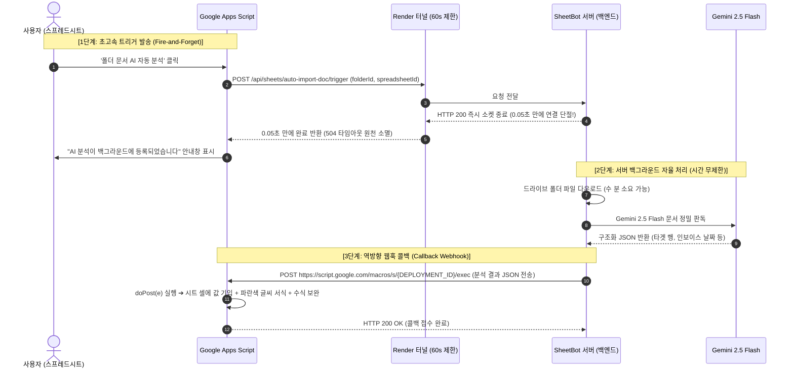
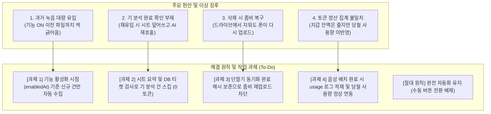
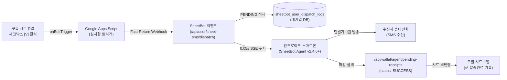

# SheetBot (시트봇) 🤖 시스템 아키텍처 및 종합 가이드

> **구글 스프레드시트와 스마트폰을 결합하는 AI 기반 Google Apps Script(GAS) 자동화 SaaS 플랫폼**  
> 운영 도메인: [https://sheetbot.cloud](https://sheetbot.cloud) | 운영 포트: `3005` (이지데스크 호스팅 기반)

---

## 📋 목차

- **시트 래핑:** [`docs/WRAPPING.md`](docs/WRAPPING.md) — **wrap** · **updateAutomation** · **bridge**. EGDesk MCP 노출 목록(선택): [`docs/WRAPPING-MCP-CATALOG.md`](docs/WRAPPING-MCP-CATALOG.md). 구현: [`WRAPPING-PLAN.md`](docs/WRAPPING-PLAN.md). 터널/런타임 키 로테이션: [`docs/RUNTIME-ROTATION.md`](docs/RUNTIME-ROTATION.md). Runtime 6-lite: `POST /api/runtime/call`, [`docs/RUNTIME-LONG-AI.md`](docs/RUNTIME-LONG-AI.md).
- **체크박스 0원 문자 발송:** [`docs/CHECKBOX-SMS-PIPELINE.md`](docs/CHECKBOX-SMS-PIPELINE.md) — 구글 시트 D열 체크박스([V]) 클릭 ➔ Apps Script 웹훅 ➔ 안드로이드 에이전트(0원 SMS) ➔ E열 결과 역반영 전 구간 상세 명세.

1. [프로젝트 개요 및 핵심 가치](#1-프로젝트-개요-및-핵심-가치)
2. [전체 시스템 아키텍처 다이어그램](#2-전체-시스템-아키텍처-다이어그램)
3. [인프라 및 배포 환경](#3-인프라-및-배포-환경)
4. [이원화 인증 및 세션 연동 구조](#4-이원화-인증-및-세션-연동-구조)
5. [AI 무역/수입 수불부 자동화 및 문서 분류 시스템](#5-ai-무역수입-수불부-자동화-및-문서-분류-시스템)
6. [터널 60초 타임아웃(504) 극복과 웹훅/비동기 아키텍처](#6-터널-60초-타임아웃504-극복과-웹훅비동기-아키텍처)
7. [데이터베이스 설계 및 데이터 흐름도](#7-데이터베이스-설계-및-데이터-흐름도)
8. [디렉토리 및 핵심 파일 구조](#8-디렉토리-및-핵심-파일-구조)
9. [최근 트러블슈팅 이력 및 운영 원칙](#9-최근-트러블슈팅-이력-및-운영-원칙)
10. [통화 녹음 AI 파이프라인 및 토큰 정산 현안 점검 & 해결 과제 목록 (To-Do)](#10-통화-녹음-ai-파이프라인-및-토큰-정산-현안-점검--해결-과제-목록-to-do)
11. [스프레드시트 체크박스 0원 문자 발송 파이프라인](#11-스프레드시트-체크박스-0원-문자-발송-파이프라인)

---

## 1. 프로젝트 개요 및 핵심 가치

SheetBot은 일반 비즈니스 사용자와 실무자가 복잡한 프로그래밍 지식 없이도 스프레드시트 업무를 완전 자동화할 수 있도록 지원하는 All-in-One 자동화 솔루션입니다.

- **원클릭 스프레드시트 래핑 (Wrap)**: 시트에 SheetBot **셸**을 한 번 부착하고(`wrap`), 이후 AI·에이전트는 **브릿지**로 시트를 읽고 `UserAutomation.gs`만 갱신(`updateAutomation`)합니다. (목표 동작 — 상세는 `docs/WRAPPING.md`)
- **AI 코파일럿 일체형 사이드바**: 시트 내부에서 직접 구동되는 단일 통합 사이드바를 통해 토큰 잔액 조회, 즉시 충전, 실시간 AI 질의응답을 제공합니다.
- **AI 폴더 감시 및 무역 수불부 자동 기입**: 구글 드라이브 폴더에 송장(Commercial Invoice), 선하증권(B/L) 등의 문서를 올리면 AI가 문서를 자율 분석하여 적합한 탭(`SPRING`, `BAND`)의 일치하는 행을 찾아 인보이스 일자를 자동 기입하고 처리완료함으로 이동합니다.
- **스마트폰 0원 양방향 알림 (SheetBot Agent2)**: 회원의 개인 스마트폰과 구글 시트를 직결하여 통신사 부가비용 없이 SMS 알림 발송 및 회신 내역 자동 기록을 수행합니다.
- **무통장 입금 자동 감지 (SheetBot Agent M)**: 운영자 계좌의 입금 내역을 실시간 감지하여 회원 토큰을 즉시 자동 충전합니다.

---

## 2. 전체 시스템 아키텍처 다이어그램

```mermaid
flowchart TB
    subgraph Client["사용자 환경 (Workspace & Mobile)"]
        Browser["웹 브라우저 (sheetbot.cloud)"]
        GoogleSheet["Google 스프레드시트 (Apps Script 내장)"]
        DriveFolder["Google 드라이브 폴더 (신규 문서 적재)"]
        PhoneAgent["스마트폰 SMS/입금 에이전트"]
    end

    subgraph EdgeNetwork["엣지 및 네트워크 게이트웨이"]
        RenderGateway["Render 터널 게이트웨이\n(tunneling-service.onrender.com)"]
        CustomDomain["공식 도메인 SSL\n(https://sheetbot.cloud)"]
    end

    subgraph NextServer["SheetBot Next.js 16 프로덕션 서버 (포트 3005)"]
        NextProxy["프록시 / 미들웨어 (src/proxy.ts)"]
        AuthLayer["인증 계층 (Header Fast-Path + NextAuth)"]
        DocApi["AI 문서 분석 API (/api/sheets/auto-import-doc)"]
        AsyncWorker["백그라운드 비동기 워커 (Async Folder Worker)"]
    end

    subgraph EGDeskCore["이지데스크 코어 인프라 (포트 8080 / MCP)"]
        MCP_Tools["Workspace MCP (Sheets, Drive, Apps Script)"]
        AICaller["AI Caller (Gemini 2.5 Flash 추론 엔진)"]
        MyDB["My DB SQLite (32개 비즈니스 대장 테이블)"]
    end

    CustomDomain --> RenderGateway
    RenderGateway --> NextProxy
    GoogleSheet -->|0.5s 웹훅 신호| CustomDomain
    DriveFolder -.->|파일 동기화| GoogleSheet
    Browser --> CustomDomain
    PhoneAgent --> CustomDomain

    NextProxy --> AuthLayer
    AuthLayer --> DocApi
    DocApi -->|Fast-Return (0.5s)| GoogleSheet
    DocApi -->|비동기 위임| AsyncWorker
    AsyncWorker --> AICaller
    AsyncWorker --> MCP_Tools
    MCP_Tools -->|직접 시트 기입 & 파일 이동| GoogleSheet
    DocApi --> MyDB
```

---

## 3. 인프라 및 배포 환경

### 1) 다중 포트 및 도메인 바인딩
- **공식 운영 도메인**: `https://sheetbot.cloud` (Render Reverse Proxy 경유 로컬 서버 직결)
- **이지데스크 터널 URL**: `https://tunneling-service.onrender.com/t/mcp-server-fxkud1/p/SheetBot`
- **운영 서버 포트**: `3005` (`Next.js 16.2.6 Turbopack`)
- **로컬 개발 포트**: `4002` (`npm run dev`)
- **이지데스크 코어 포트**: `8080` (My DB 및 MCP 게이트웨이)

### 2) 프로덕션 배포 표준 원칙 (Never CLI Manual Build)
- 본 프로젝트의 운영 서버는 임의로 터미널에서 수동 기동하지 않고, **이지데스크 코딩 서버 도구(`coding_start_server`)의 `forceBuild: true`를 통해서만 빌드 및 운영 관리**됩니다.
- `coding_start_server` 실행 시 최신 소스 스냅샷이 컴파일되어 포트가 안전하게 재바인딩됩니다.

---

## 4. 이원화 인증 및 세션 연동 구조

SheetBot은 구글 계정 보안과 Google Workspace 권한 획득을 위해 **2중 인증 파이프라인**을 운영합니다:

1. **Header Fast-Path (0초 인증)**:
   - Google Apps Script에서 API 호출 시 `X-User-Email` 및 `X-SheetBot-User-Email` 헤더를 직접 주입합니다.
   - 서버는 세션 쿠키나 DB 탐색 지연(과거 11.4초 소요)을 완전히 건너뛰고 **0ms 즉시 사용자 식별**을 완료합니다.
2. **NextAuth 세션 폴백**:
   - 웹 브라우저 환경에서는 기존 구글 OAuth 2.0 세션을 활용하여 로그인 및 대시보드 권한을 확인합니다.

---

## 5. AI 무역/수입 수불부 자동화 및 문서 분류 시스템

구글 스프레드시트 수입/발주 현황 장부 자동화를 위한 전용 파이프라인입니다.

### 1) 관리 탭 분류 규칙
- **`SPRING` 탭**:
  - 통화: 미국 달러 (`$`) / 공급사: Bal Seal Engineering / 품목: 스프링 (`X578630` 등)
  - 발주번호 형식: `S25xx`, `S26xx`
  - 인보이스 일자 기입 열: **N열 (14번째 열)**
  - 결제 조건: 통상 **NET60** (인보이스일자 + 60일 송금)
- **`BAND` 탭**:
  - 통화: 유럽 유로 (`€`) / 품목: 밴드 (FLAT SPRING, BAND 등)
  - 발주번호 형식: `B25xx`, `B26xx`
  - 인보이스 일자 기입 열: **J열 (10번째 열)**
  - 결제 조건: 통상 **NET30** (인보이스일자 + 30일 송금)

### 2) 서식 및 수식 연동 원칙
- **개별 기입 셀 전용 파란색 글씨 (`#1a73e8`, bold)**:
  - 열 전체를 물들이지 않고, **AI가 분석하여 값을 입력한 바로 그 셀만 정확히 진한 파란색 굵은 글씨**로 표시합니다.
- **수식 자동 보완 (Auto Formula Fill)**:
  - 대상 행의 수식 셀이 비어 있는 경우, 표준 수식을 자동으로 안전하게 채워 넣습니다:
    - `SPRING` 탭: **AA열 (송금예정일)** `=N{row}+60`, W열 `=U{row}*10`, Y열 `=X{row}*J{row}`, Z열 `=R{row}+U{row}+Y{row}`
    - `BAND` 탭: **V열 (송금예정일)** `=J{row}+30`, R열 `=P{row}*10`, T열 `=S{row}*F{row}`, U열 `=T{row}+P{row}+M{row}`
  - 기존에 작성된 수식이나 고정값은 절대 덮어쓰지 않고 100% 보존합니다.

### 3) 폴더 2단 자동 분리 정리
- 정상 처리된 문서: **`📁 [완료] 처리완료함`**으로 자동 이동
- 비지원 확장자 또는 분석 불가 문서: **`📁 [확인필요] 미처리보관함`**으로 자동 분리 이동

---

## 6. 터널 60초 타임아웃(504)과 진정한 웹훅/비동기 아키텍처

> ⚠️ **[현주소 및 강력 경고] 현재 구현은 진정한 웹훅이 아니며, 여전히 동기식 대기 상태입니다.**  
> 현재 Apps Script의 `runAiFolderDocSync()`는 `UrlFetchApp.fetch()`를 호출한 채 소켓을 닫지 않고 응답을 동기식으로 기다립니다.  
> 서버 내부에서 백그라운드 태스크를 실행하더라도, Node.js 이벤트 루프나 터널 프록시 연결이 즉각 분리되지 않아 소켓이 유지되며, 결국 60초 제한에 걸려 **`504 tunnel_timeout`이 재발**하고 있습니다.  
> 따라서 **"무늬만 비동기인 현재 방식"에서 "완전 분리된 양방향 웹훅(Two-Way Webhook)"으로의 전환이 필수적**입니다.

---

### 1) 진정한 웹훅(Two-Way Async Webhook) 파이프라인 설계



---

### 2) 🔍 웹훅 출시 시, '새로운 Apps Script 웹앱 URL'을 어떻게 찾는가?

진정한 웹훅 구조를 완성하려면 서버가 분석 결과를 역으로 쏴줄 **Google Apps Script의 웹앱 엔드포인트 URL(`https://script.google.com/macros/s/{DEPLOYMENT_ID}/exec`)**을 시스템이 알고 있어야 합니다. 이를 자동으로 찾고 관리하는 3대 전략은 다음과 같습니다:

#### 【전략 B (최종 확정 채택 전략)】 비동기 실행 시 자신의 Webhook URL을 동적으로 직접 동봉 전송 (Self-Enclosed Webhook URL)
- **핵심 원리**: 사전에 복잡한 DB 등록이나 매핑 작업을 할 필요 없이, **Apps Script가 비동기 트리거 요청을 서버로 보낼 때 자기 자신의 웹앱 URL(`ScriptApp.getService().getUrl()`)을 페이로드(`webhookUrl`)에 담아 함께 전송**합니다!
- **동작 절차**:
  1. **Apps Script (트리거 발송)**:
     ```javascript
     var myWebhookUrl = ScriptApp.getService().getUrl(); // 자신의 웹앱 배포 URL 동적 획득
     var payload = {
       spreadsheetId: ssId,
       folderId: folderId,
       webhookUrl: myWebhookUrl, // 👈 자신의 콜백 URL을 페이로드에 동봉!
       userEmail: userEmail
     };
     UrlFetchApp.fetch(SHEETBOT_API_URL, {
       method: "post",
       contentType: "application/json",
       payload: JSON.stringify(payload)
     });
     ```
  2. **서버 백엔드 (0.05초 즉각 응답 & 백그라운드 처리)**:
     - 요청을 받자마자 0.05초 만에 HTTP 200으로 연결을 끊고,
     - 백그라운드에서 AI 분석을 여유롭게 완수합니다.
  3. **서버 백엔드 (역방향 콜백)**:
     - 분석 완료 후, 요청 페이로드에 들어있던 `webhookUrl`로 직접 POST 요청을 전송하여 분석 결과를 반환합니다.
  4. **Apps Script (`doPost(e)`)**:
     - 역으로 도착한 웹훅 데이터를 받아 시트 셀 기입, 파란색 글씨 서식(`cell.setFontColor("#1a73e8")`), 수식 보완을 완수합니다.
- **압도적 장점**:
  - Apps Script 배포 ID나 버전이 바뀌더라도 **항상 요청 당시의 최신 URL이 동적으로 서버에 전달**되므로 URL 불일치 오류가 원천 방지됩니다.
  - 별도의 사전 DB 저장/조회 오버헤드가 전혀 없는 가장 우아하고 견고한 아키텍처입니다.

#### 【전략 A (보조)】 MCP 도구를 통한 사전 배포 및 URL 조회 (`apps_script_list_deployments`)
- 웹앱 배포가 아예 생성되어 있지 않은 경우, `egdesk-apps-script` MCP 도구를 통해 신규 웹앱을 배포하고 URL을 생성하는 관리자/초기화 전용 보조 도구로 활용합니다.

#### 【전략 C (수동 백업)】 Google Apps Script IDE 수동 확인
- 스프레드시트 ➔ `확장 프로그램` ➔ `Apps Script` ➔ 우측 상단 `배포 (Deploy)` ➔ `배포 관리` ➔ `웹 앱 URL` 복사 및 점검용.

---

### 3) 웹훅 전환 시 기대 효과
1. **소켓 타임아웃 100% 영구 소멸**: Apps Script와 서버 간의 연결이 0.05초 만에 완전히 끊기므로 Render 프록시의 60초 타임아웃에 절대 걸리지 않습니다.
2. **대용량 다중 문서 무제한 처리**: 폴더 내에 10장, 50장의 PDF가 있더라도 백엔드 큐에서 여유롭게 5분, 10분 동안 처리한 뒤 시트에 콜백할 수 있습니다.
3. **완벽한 셀 서식 보장**: 시트 내부의 `doPost(e)`가 실행되므로 구글 시트 네이티브 메소드(`cell.setFontColor("#1a73e8")`)가 100% 무결점으로 동작합니다.

---

## 7. 데이터베이스 설계 및 데이터 흐름도

이지데스크 My DB(SQLite) 기반 32개 핵심 테이블 중 수불부 및 AI 관련 주요 대장:

| 테이블명 | 국문 대장명 | 핵심 컬럼 | 주요 용도 |
| :--- | :--- | :--- | :--- |
| **`sheetbot_users`** | 회원 마스터 대장 | `email`, `role`, `status`, `last_login_at` | 회원 식별 및 관리자 권한 확인 |
| **`sheetbot_user_sheet_bindings`** | 시트 연동 대장 | `user_email`, `spreadsheet_id`, `folder_id` | 스프레드시트와 드라이브 폴더 영구 바인딩 |
| **`sheetbot_ai_usage_logs`** | AI 사용료 감사 대장 | `user_email`, `action`, `tokens_used`, `details` | Gemini LLM 토큰 소모량 및 과금 감사 로그 |
| **`sheetbot_faqs`** | FAQ 관리 대장 | `category`, `question`, `answer`, `sort_order` | 60초 TTL 인메모리 캐시 기반 초고속 FAQ 제공 |

---

## 8. 디렉토리 및 핵심 파일 구조

```
C:\dev\SheetBot\
├── README.md                      # [현재 파일] 프로젝트 종합 기술 문서
├── docs/WRAPPING.md               # 시트 래핑 스펙 (target design)
├── docs/WRAPPING-PLAN.md          # 구현 계획·파일 맵 (마이그레이션용)
├── AGENTS.md                      # AI 어시스턴트 전용 개발 및 운영 절대 원칙
├── egdesk-helpers.ts              # 이지데스크 백엔드 통신 표준 라이브러리 (MCP 연동)
├── src/
│   ├── app/
│   │   ├── api/
│   │   │   ├── sheets/
│   │   │   │   └── auto-import-doc/
│   │   │   │       └── route.ts   # AI 문서 분석 및 비동기 폴더 워커 엔드포인트
│   │   │   ├── faqs/              # 초경량 캐시 FAQ API
│   │   │   ├── admin/             # 관리자 제어 센터 API군
│   │   │   └── wallet/            # 토큰 지갑 및 트랜잭션 API
│   │   ├── dashboard/             # 워크스페이스 대시보드
│   │   └── wrap/page.tsx          # 원클릭 스프레드시트 래핑
│   └── lib/
│       ├── auth.ts                # NextAuth 및 이메일 식별 유틸
│       ├── token-wallet.ts        # 토큰 차감 및 잔액 감사 로직
│       └── server-cache.ts        # 인메모리 TTL 캐시 유틸
```

---

## 9. 최근 트러블슈팅 이력 및 운영 원칙

1. **504 tunnel_timeout 및 인증 지연 해결**:
   - `X-User-Email` 헤더 기반 0ms 인증 추출 적용
   - Gemini 프롬프트를 10줄 이내 구조화 JSON 스키마로 경량화하여 추론 시간 대폭 단축
2. **500 ReferenceError (`logFile is not defined`) 해결**:
   - 서버 코드 내 디버깅 잔여 코드 완전 제거 및 `forceBuild: true`를 통한 프로덕션 번들 정상화
3. **개별 기입 셀 서식 독립화**:
   - 열 전체에 걸렸던 조건부 서식을 배제하고, AI가 값을 입력한 특정 셀 1개에만 정확히 파란색 글씨(`#1a73e8`, bold)를 적용하도록 개선
4. **수식 누락 방지 (Auto Formula Fill)**:
   - 인보이스 일자 기입 시 비어 있는 송금예정일(`=N+60`), 인천세과, 결제금액, 합계 수식을 자동 보완하도록 안전망 탑재
5. **프로덕션 배포 불변 원칙**:
   - 소스코드 변경 후 프로덕션 반영은 반드시 `coding_start_server` with `forceBuild: true` MCP를 통해서만 수행


---

## 10. 통화 녹음 AI 파이프라인 및 토큰 정산 현안 점검 & 해결 과제 목록 (To-Do)

사용자 관점에서 불필요한 비용 낭비와 시스템 오동작을 원천 차단하고, 투명한 토큰 과금 체계를 확립하기 위한 **핵심 현안 및 향후 작업 목록(To-Do)**입니다.



---

### 1) 주요 현안 및 원인 분석

1. **지갑 잔액 차감 vs 당월 사용량 카드 미반영 불일치**
   - **현상**: 통화 녹음 AI 분석이 완료되면 지갑 잔액(`balance_tokens`)은 정상 차감되는데, 대시보드의 '당월 사용량' 카드나 사용 통계에는 수치가 늘어나지 않음.
   - **원인**: 음성 비동기 배치 워커(`ai-batch-sweeper`)에서 토큰을 차감할 때 지갑 잔액(`deductTokens`)만 깎고, AI 사용량 감사 대장(`sheetbot_ai_usage_logs`)에 로그를 적재하거나 누적 사용량(`total_used_tokens`)을 갱신하는 로직이 누락되어 대시보드 집계와 불일치 발생.

2. **기능 활성화 이전 과거 녹음 파일 무차별 유입**
   - **현상**: 스마트폰에서 통화 녹음 백업 스위치를 켰을 때, 단말기에 저장되어 있던 수일~수개월 전의 과거 통화 녹음 파일들까지 한꺼번에 대량 업로드됨.
   - **원인**: 단말기 검색 로직이 단순 7일 이내 파일 전체를 탐색하도록 되어 있어, 사용자가 기능을 켠 시점과 무관하게 과거 녹음들이 대량으로 쏟아져 들어옴.

3. **기 분석 완료 여부 확인 로직 부재로 인한 토큰 중복 누수**
   - **현상**: 이미 AI 3줄 요약 및 STT 분석이 완료된 파일임에도 불구하고, 파일이 재유입되거나 동기화될 때 기존 행을 `⏳ AI 배치 분석 대기 중...`으로 덮어쓰고 AI 배치를 계속 재요청하여 토큰이 지속적으로 차감됨.
   - **원인**: 서버 파이프라인에서 시트 E열(AI 요약)의 기 완료 여부나 DB 배치 작업 이력(`SUCCEEDED`)을 선제 확인하여 스킵하는 가드가 결여되어 있음.

4. **구글 드라이브 파일 삭제 시 좀비 복구(재업로드) 현상**
   - **현상**: 사용자가 불필요한 통화 녹음 파일을 구글 드라이브에서 삭제하더라도, 스마트폰 단말기가 25초 주기 루프에서 이를 다시 새 파일로 오인하여 계속 재업로드함.
   - **원인**: 단말기 내부에서 '이미 전송 완료된 파일 목록'이 영구 보존되지 않거나 초기화되어, 드라이브 상에서 파일이 사라지면 스마트폰이 다시 올리는 현상 발생.

5. **완전 자동화 유지 필요성 (수동 전환 불가)**
   - 사용자가 일일이 수동 버튼을 눌러 올리는 방식은 절대 불가하며, 사용자가 신경 쓰지 않아도 백그라운드에서 신규 통화만 알아서 드라이브와 시트로 들어가는 완전 자동화 UX는 필수로 유지되어야 함.

---

### 2) 단계별 해결 과제 목록 (To-Do List)

- [ ] **[To-Do 1: 스마트폰] 기능 켠 시점(`enabledAt`) 이후 신규 파일만 수집 가드 탑재**
  - 통화 녹음 스위치를 켠 정확한 시각(`prefs.callRecordingEnabledAt`)을 기록.
  - 파일 수정일시가 기능 켠 시점 이전인 과거 파일(`file.lastModified() < enabledAt`)은 무조건 탐색/업로드에서 제외.
  - 신규 통화 녹음 건에 대해서는 0클릭 백그라운드 완전 자동 수집 유지.

- [ ] **[To-Do 2: 단말기] 업로드 완료 이력 영구 기억 및 좀비 재업로드 차단**
  - 이미 전송된 파일명/해시를 단말기 로컬 저장소에 영구 보존.
  - 구글 드라이브나 시트에서 파일을 삭제하더라도 스마트폰이 이를 다시 복구 업로드하지 않도록 방어.

- [ ] **[To-Do 3: 서버] 시트 및 DB 기반 기 분석 완료 파일 스킵 가드 (0 토큰 보장)**
  - 시트 C열(파일명) 매칭 시 E열(AI 3줄 요약)에 이미 유의미한 분석 결과가 존재하면, 기존 요약을 절대 `대기 중`으로 지우지 않고 보존.
  - `sheetbot_ai_batch_jobs` 대장을 사전 조회하여 해당 파일명이 이미 `SUCCEEDED` 또는 `PENDING` 상태이면 AI 배치를 제출하지 않고 즉시 스킵하여 0 토큰 보장.

- [ ] **[To-Do 4: 정산/대시보드] 토큰 차감과 당월 사용량 카드 데이터 동기화**
  - 음성 배치 완료 및 토큰 차감 시 `recordAiUsageLog`를 필수로 경유하여 `sheetbot_ai_usage_logs` 대장에 정식 적재.
  - 회원의 `total_used_tokens` 누적 사용량을 함께 갱신하여, 대시보드의 '당월 사용량' 카드와 지갑 잔액이 정확히 일치하도록 연동.

- [ ] **[To-Do 5: 파일 정리] 미완료 잔여 임시 파일(.pending) 정리 및 클라이언트 알림 정비**
  - 과거 업로드 중단 등으로 드라이브에 남아있는 `.pending-...` 더미 파일 처리 가이드 수립.


---

## 11. 스프레드시트 체크박스 0원 문자 발송 파이프라인

> 📖 **상세 기술 지침서:** [`docs/CHECKBOX-SMS-PIPELINE.md`](docs/CHECKBOX-SMS-PIPELINE.md) (Apps Script 전체 소스 코드, API 규격, 트러블슈팅 가이드 포함)

### 1) 시스템 개요
구글 스프레드시트의 `문자발송목록` 탭에서 **D열의 체크박스(`[V]`)를 클릭**하면, Google Apps Script 설치형 트리거(`onEditTrigger`)가 작동하여 SheetBot 백엔드로 웹훅을 발송하고, 사용자의 안드로이드 스마트폰(SheetBot Agent v2.4.6+)에서 **통신사 기본 문자(SMS)를 0원에 발송**한 뒤, 시트 E열에 발송 완료 일시를 자동 기록하는 파이프라인입니다.



### 2) 핵심 구성 요소 요약
1. **Google Apps Script**:
   - `onEditTrigger(e)`: 단순 트리거(`onEdit`)의 `UrlFetchApp` 권한 차단을 극복하기 위해 **설치형 트리거(Installable Trigger)**로 등록.
   - D열(4번째 열) 체크박스가 `TRUE`로 변경될 때만 실행되며, 즉시 E열에 `⏳ 발송 준비중...`을 기입하여 중복 클릭 방지.
   - A열(수신번호), B열(고객명), C열(문자내용), `userEmail`을 조립하여 `POST /api/user/sheet-sms/dispatch`로 발송.
2. **백엔드 대기열 및 SSE 푸시**:
   - `sheetbot_user_dispatch_logs` 테이블에 숫자형 `logId`와 함께 `PENDING` 상태로 저장.
   - `realtimeHub.notifyDispatchAdded(userEmail, logId, recipient)`를 통해 모바일 기기 SSE 연결(`/api/user/dispatch/stream`)로 0.05초 만에 신호 푸시.
3. **안드로이드 에이전트 (v2.4.6+)**:
   - `startDispatchSseLoop()`가 실시간 수신하여 백그라운드에서 SMS 즉각 발송.
   - 발송 완료 즉시 `POST /api/wallet/agent/pending-receipts`를 호출하여 대기열을 `SUCCESS`로 청소하고, 시트 E열에 `✅ 발송완료 (MM. DD. HH:mm)` 자동 기록.
