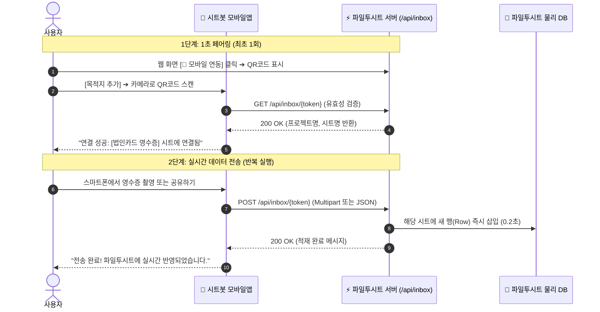

# 📱 [공식 가이드] 시트봇 모바일 에이전트앱 ↔ 파일투시트(FileToSheet) 직결 연동 기술 명세서

> **버전**: v1.0.0 (Release)  
> **대상**: 시트봇 모바일앱(Android / iOS / Flutter) 클라이언트 개발팀  
> **서버 호환성**: 파일투시트 API v1 (`/api/inbox/*`)  
> **작성 일시**: 2026-10-18  

---

## 1. 연동 개요 및 아키텍처

본 문서는 **시트봇 모바일앱(SheetBot Mobile Agent)**에서 스마트폰 카메라로 촬영한 영수증, 발주서, 명함 및 문자 데이터를 **구글 드라이브나 구글 스프레드시트를 거치지 않고**, 웹 서비스인 **파일투시트(FileToSheet)의 특정 프로젝트/시트로 즉시 직결 적재(Incoming Webhook)**하기 위한 기술 규격입니다.



---

## 2. QR 코드 페이로드 포맷 규격

파일투시트 웹 화면의 `[📱 모바일 연동]` 모달에 표시되는 QR 코드는 아래와 같은 **표준 JSON 문자열**을 인코딩하고 있습니다.

### QR Code Raw String (JSON):
```json
{
  "service": "FileToSheet",
  "action": "sheet_ingest",
  "token": "fts_inbox_g3ayjwzb7q",
  "endpoint": "https://filetosheet.com/api/inbox/fts_inbox_g3ayjwzb7q",
  "sheetName": "법인카드_영수증_대장",
  "projectName": "2026 하반기 지출결의",
  "projectId": "proj_179230584"
}
```

### 필드 설명:
| 필드명 | 타입 | 설명 |
| :--- | :---: | :--- |
| `service` | `string` | `"FileToSheet"` 고정값 (식별 플래그) |
| `action` | `string` | `"sheet_ingest"` (시트 직결 적재 동작) |
| `token` | `string` | 고유 수신 토큰 (영구 식별 키) |
| `endpoint` | `string` | 데이터 전송 대상 완전한 HTTP URL |
| `sheetName` | `string` | 연동될 파일투시트의 대상 시트 이름 |
| `projectName`| `string` | 대상 프로젝트 이름 |

> **앱 클라이언트 처리 팁**:  
> 사용자가 QR코드를 스캔했을 때 `service === "FileToSheet"`인 경우, 앱 내부 로컬 DB(SharedPreferences 또는 Room)에 `token`, `endpoint`, `sheetName`을 저장하고 즉시 페어링 검증 API(1번)를 호출하십시오.

---

## 3. API 상세 명세

### API 1. 토큰 유효성 및 페어링 검증 (GET)

모바일앱이 QR 코드를 스캔하거나 사용자가 토큰을 직접 붙여넣었을 때, 대상 시트가 실존하고 활성 상태인지 확인합니다.

- **HTTP Method**: `GET`
- **URL**: `{endpoint}` 또는 `https://filetosheet.com/api/inbox/{token}`
- **Headers**:
  ```http
  Accept: application/json
  ```

#### 성공 응답 (HTTP 200 OK):
```json
{
  "success": true,
  "valid": true,
  "service": "FileToSheet",
  "token": "fts_inbox_g3ayjwzb7q",
  "projectId": "proj_179230584",
  "projectName": "2026 하반기 지출결의",
  "sheetName": "법인카드_영수증_대장",
  "createdAt": "2026-10-18T06:04:54.123Z",
  "message": "[법인카드_영수증_대장]와 모바일 페어링이 준비되었습니다."
}
```

#### 실패 응답 (HTTP 401 / 404):
```json
{
  "success": false,
  "valid": false,
  "error": "유효하지 않거나 만료된 토큰입니다."
}
```

---

### API 2. 사진/문서/데이터 수신 전송 (POST)

스마트폰 카메라로 촬영한 사진 파일이나 추출된 영수증 데이터를 파일투시트 시트로 전송합니다.  
**Multipart/Form-Data(사진 바이너리)** 또는 **JSON(정형 데이터)** 2가지 방식을 모두 지원합니다.

- **HTTP Method**: `POST`
- **URL**: `{endpoint}` 또는 `https://filetosheet.com/api/inbox/{token}`

#### [방식 A] 사진/파일 직접 전송 (`multipart/form-data`) — 가장 권장

| Form 파라미터명 | 타입 | 필수 여부 | 설명 |
| :--- | :---: | :---: | :--- |
| `file` | `Binary/File` | **필수** | 영수증/발주서/명함 이미지 (`.jpg`, `.png`, `.pdf`) |
| `memo` | `string` | 선택 | 사용자 메모 (예: "고객사 접대 미팅") |
| `ocrType` | `string` | 선택 | 문서 종류 (`RECEIPT`, `ORDER`, `INVOICE`, `GENERIC`) |
| `deviceId` | `string` | 선택 | 스마트폰 기기 식별명 (예: "Galaxy S24 Ultra") |

#### [방식 B] 정형 데이터 직접 전송 (`application/json`)

스마트폰 앱 자체에서 이미 OCR이나 텍스트를 추출한 경우 사용합니다.

```json
{
  "fileName": "20261018_스타벅스_영수증.jpg",
  "memo": "외근 중 고객사 미팅 음료대",
  "amount": 14800,
  "rowData": {
    "일자": "2026-10-18",
    "가맹점명": "스타벅스 역삼포스코점",
    "금액": 14800,
    "결제수단": "법인카드",
    "비고": "모바일 앱 카메라 촬영 건"
  }
}
```

#### 성공 응답 (HTTP 200 OK):
```json
{
  "success": true,
  "message": "[법인카드_영수증_대장] 시트에 1건이 성공적으로 적재되었습니다.",
  "targetSheet": "법인카드_영수증_대장",
  "projectId": "proj_179230584",
  "token": "fts_inbox_g3ayjwzb7q",
  "receivedAt": "2026-10-18T06:05:00.789Z",
  "data": {
    "일자": "2026-10-18",
    "가맹점명": "스타벅스 역삼포스코점",
    "금액": 14800,
    "결제수단": "법인카드",
    "비고": "모바일 앱 카메라 촬영 건"
  }
}
```

---

## 4. 클라이언트 구현 샘플 코드

### 1) Android (Kotlin + OkHttp)

```kotlin
import okhttp3.*
import okhttp3.MediaType.Companion.toMediaTypeOrNull
import okhttp3.RequestBody.Companion.asRequestBody
import java.io.File

class FileToSheetClient(private val endpoint: String) {
    private val client = OkHttpClient()

    // 1. QR코드 스캔 후 페어링 검증
    fun verifyPairing(onResult: (Boolean, String?) -> Unit) {
        val request = Request.Builder().url(endpoint).get().build()
        client.newCall(request).enqueue(object : Callback {
            override fun onResponse(call: Call, response: Response) {
                onResult(response.isSuccessful, response.body?.string())
            }
            override fun onFailure(call: Call, e: java.io.IOException) {
                onResult(false, e.message)
            }
        })
    }

    // 2. 영수증 사진 파일 전송
    fun uploadReceiptPhoto(imageFile: File, memo: String, onResult: (Boolean) -> Unit) {
        val requestBody = MultipartBody.Builder()
            .setType(MultipartBody.FORM)
            .addFormDataPart(
                "file",
                imageFile.name,
                imageFile.asRequestBody("image/jpeg".toMediaTypeOrNull())
            )
            .addFormDataPart("memo", memo)
            .addFormDataPart("ocrType", "RECEIPT")
            .build()

        val request = Request.Builder()
            .url(endpoint)
            .post(requestBody)
            .build()

        client.newCall(request).enqueue(object : Callback {
            override fun onResponse(call: Call, response: Response) {
                onResult(response.isSuccessful)
            }
            override fun onFailure(call: Call, e: java.io.IOException) {
                onResult(false)
            }
        })
    }
}
```

### 2) Flutter / Dart (http 패키지)

```dart
import 'dart:io';
import 'package:http/http.dart' as http;

Future<bool> uploadToSheet({
  required String endpoint,
  required File imageFile,
  required String memo,
}) async {
  final uri = Uri.parse(endpoint);
  final request = http.MultipartRequest('POST', uri)
    ..fields['memo'] = memo
    ..fields['ocrType'] = 'RECEIPT'
    ..files.add(await http.MultipartFile.fromPath('file', imageFile.path));

  final response = await request.send();
  return response.statusCode == 200;
}
```

### 3) cURL 모의 테스트 명령

```bash
# 1. 페어링 검증
curl -X GET "http://localhost:4003/api/inbox/fts_inbox_g3ayjwzb7q"

# 2. 사진 파일 전송 (Multipart)
curl -X POST "http://localhost:4003/api/inbox/fts_inbox_g3ayjwzb7q" \
  -F "file=@/path/to/receipt.jpg" \
  -F "memo=스타벅스 미팅" \
  -F "ocrType=RECEIPT"

# 3. JSON 데이터 전송
curl -X POST "http://localhost:4003/api/inbox/fts_inbox_g3ayjwzb7q" \
  -H "Content-Type: application/json" \
  -d '{
    "fileName": "receipt.jpg",
    "memo": "강남역 점심 식대",
    "amount": 25000,
    "rowData": {
      "일자": "2026-10-18",
      "가맹점명": "을지다락 강남점",
      "금액": 25000
    }
  }'
```

---

## 5. 모바일앱 권장 UI/UX 흐름

1. **설정 메뉴 내 전송 목적지 관리**:
   - `[구글 스프레드시트]`와 `[파일투시트(FileToSheet)]` 라디오 버튼 제공.
2. **파일투시트 선택 시**:
   - **`[📷 QR 코드 스캔]`** 버튼 터치 ➔ 카메라 프리뷰 활성화 ➔ PC 화면 QR 인식 ➔ 대상 시트명 팝업 표시 및 저장.
3. **촬영 및 전송 완료 화면**:
   - 사진 촬영 후 전송 완료 시:  
     `"✅ [법인카드_영수증_대장] 시트에 1건이 전송되었습니다!"`  
     녹색 토스트 알림 노출 후 카메라 복귀.

---

> **기술 문의 및 지원**:  
> 본 연동과 관련한 추가 문의나 엔드포인트 커스텀이 필요한 경우 파일투시트 백엔드 개발팀으로 문의 바랍니다.
