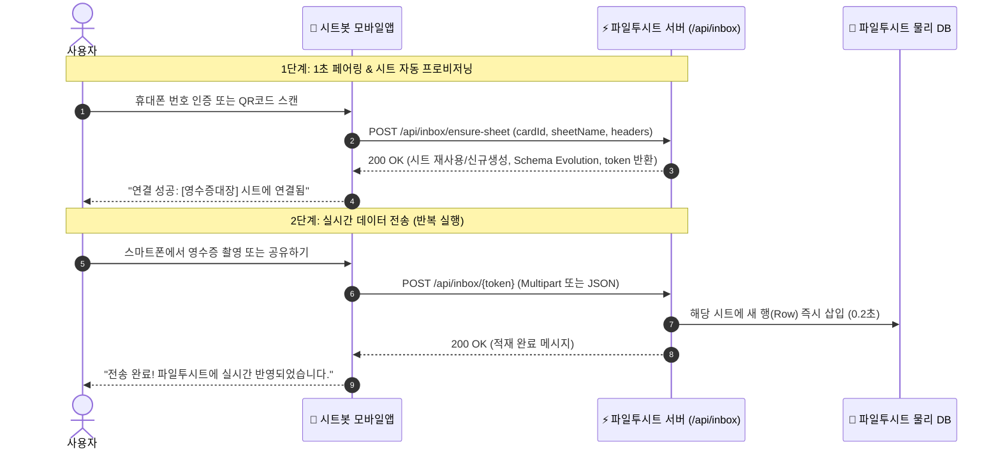

# 📱 [공식 가이드] 시트봇 모바일 에이전트앱 ↔ 파일투시트(FileToSheet) 직결 연동 기술 명세서

> **버전**: v1.1.0 (Release)  
> **대상**: 시트봇 모바일앱(Android / iOS / Flutter) 클라이언트 개발팀  
> **서버 호환성**: 파일투시트 API v1 (`/api/inbox/*`)  
> **작성 일시**: 2026-10-23  

---

## 1. 연동 개요 및 아키텍처

본 문서는 **시트봇 모바일앱(SheetBot Mobile Agent)**에서 스마트폰 카메라로 촬영한 영수증, 발주서, 명함 및 문자 데이터를 **구글 드라이브나 구글 스프레드시트를 거치지 않고**, 웹 서비스인 **파일투시트(FileToSheet)의 특정 프로젝트/시트로 즉시 직결 적재(Incoming Webhook)**하기 위한 기술 규격입니다.



---

## 2. QR 코드 페이로드 포맷 규격

파일투시트 웹 화면의 `[📱 모바일 연동]` 모달에 표시되는 QR 코드는 아래와 같은 **표준 JSON 문자열**을 인코딩하고 있습니다.

### QR Code Raw String (JSON):
```json
{
  "service": "FileToSheet",
  "action": "sheet_ingest",
  "token": "fts_inbox_g3ayjwzb7q",
  "endpoint": "https://file2sheet.cloud/api/inbox/fts_inbox_g3ayjwzb7q",
  "sheetName": "법인카드_영수증_대장",
  "projectName": "2026 하반기 지출결의",
  "projectId": "proj_179230584"
}
```

### 필드 설명:
| 필드명 | 타입 | 설명 |
| :--- | :---: | :--- |
| `service` | `string` | `"FileToSheet"` 고정값 (식별 플래그) |
| `action` | `string` | `"sheet_ingest"` (시트 직결 적재 동작) |
| `token` | `string` | 고유 수신 토큰 (영구 식별 키) |
| `endpoint` | `string` | 데이터 전송 대상 완전한 HTTP URL |
| `sheetName` | `string` | 연동될 파일투시트의 대상 시트 이름 |
| `projectName`| `string` | 대상 프로젝트 이름 |

---

## 3. API 상세 명세

### API 1. 토큰 유효성 및 페어링 검증 (GET)

모바일앱이 QR 코드를 스캔하거나 사용자가 토큰을 직접 붙여넣었을 때, 대상 시트가 실존하고 활성 상태인지 확인합니다.

- **HTTP Method**: `GET`
- **URL**: `{endpoint}` 또는 `https://file2sheet.cloud/api/inbox/{token}`
- **Headers**:
  ```http
  Accept: application/json
  ```

#### 성공 응답 (HTTP 200 OK):
```json
{
  "success": true,
  "valid": true,
  "service": "FileToSheet",
  "token": "fts_inbox_g3ayjwzb7q",
  "projectId": "proj_179230584",
  "projectName": "2026 하반기 지출결의",
  "sheetName": "법인카드_영수증_대장",
  "createdAt": "2026-10-18T06:04:54.123Z",
  "message": "[법인카드_영수증_대장]와 모바일 페어링이 준비되었습니다."
}
```

#### 실패 응답 (HTTP 401 / 404):
```json
{
  "success": false,
  "valid": false,
  "error": "유효하지 않거나 만료된 토큰입니다."
}
```

---

### API 2. 사진/문서/데이터 수신 전송 (POST)

스마트폰 카메라로 촬영한 사진 파일이나 추출된 영수증 데이터를 파일투시트 시트로 전송합니다.  
**Multipart/Form-Data(사진 바이너리)** 또는 **JSON(정형 데이터)** 2가지 방식을 모두 지원합니다.

- **HTTP Method**: `POST`
- **URL**: `{endpoint}` 또는 `https://file2sheet.cloud/api/inbox/{token}`

#### [방식 A] 사진/파일 직접 전송 (`multipart/form-data`) — 가장 권장

| Form 파라미터명 | 타입 | 필수 여부 | 설명 |
| :--- | :---: | :---: | :--- |
| `file` | `Binary/File` | **필수** | 영수증/발주서/명함 이미지 (`.jpg`, `.png`, `.pdf`) |
| `memo` | `string` | 선택 | 사용자 메모 (예: "고객사 접대 미팅") |
| `ocrType` | `string` | 선택 | 문서 종류 (`RECEIPT`, `BUSINESS_CARD`, `ORDER`, `INVOICE`, `GENERIC`) |
| `deviceId` | `string` | 선택 | 스마트폰 기기 식별명 (예: "Galaxy S24 Ultra") |

#### [방식 B] 정형 데이터 직접 전송 (`application/json`)

스마트폰 앱 자체에서 이미 OCR이나 텍스트를 추출한 경우 사용합니다.

```json
{
  "fileName": "20261018_스타벅스_영수증.jpg",
  "memo": "외근 중 고객사 미팅 음료대",
  "amount": 14800,
  "rowData": {
    "일자": "2026-10-18",
    "가맹점명": "스타벅스 역삼포스코점",
    "금액": 14800,
    "결제수단": "법인카드",
    "비고": "모바일 앱 카메라 촬영 건"
  }
}
```

#### 성공 응답 (HTTP 200 OK):
```json
{
  "success": true,
  "message": "[법인카드_영수증_대장] 시트에 1건이 성공적으로 적재되었습니다.",
  "targetSheet": "법인카드_영수증_대장",
  "projectId": "proj_179230584",
  "token": "fts_inbox_g3ayjwzb7q",
  "receivedAt": "2026-10-18T06:05:00.789Z",
  "data": {
    "일자": "2026-10-18",
    "가맹점명": "스타벅스 역삼포스코점",
    "금액": 14800,
    "결제수단": "법인카드",
    "비고": "모바일 앱 카메라 촬영 건"
  }
}
```

---

### API 3. 시트 자동 프로비저닝 및 스키마 확장 (POST)

모바일 카드가 활성화되거나 데이터를 최초 전송할 때 대상 시트를 자동으로 생성·조회하고 헤더 스키마를 동기화합니다.

- **호출 URL**: `POST https://file2sheet.cloud/api/inbox/ensure-sheet`  
  *(로컬 개발 시: `http://localhost:4007/api/inbox/ensure-sheet`)*
- **Content-Type**: `application/json`

#### Request Body:
```json
{
  "phoneNumber": "01072165884",
  "cardId": "receipt_scanner",
  "sheetName": "영수증대장",
  "headers": [
    "일련번호", "거래일자", "상호", "품목",
    "공급가액", "부가가치세", "합계금액", "결제수단"
  ]
}
```

#### Response (HTTP 200 OK):
```json
{
  "success": true,
  "isNew": true,
  "projectId": 46,
  "sheetName": "영수증대장",
  "headers": ["일련번호", "거래일자", "상호", "품목", "공급가액", "부가가치세", "합계금액", "결제수단"],
  "token": "fts_inbox_wqxwabdt39",
  "webhookUrl": "https://file2sheet.cloud/api/inbox/fts_inbox_wqxwabdt39"
}
```

#### 핵심 특징:
- **멱등성 보장 (Idempotency)**: 중복 호출 시 이미 존재하는 시트를 찾아 안전하게 재사용합니다.
- **스키마 자동 진화 (Schema Evolution)**: 모바일 카드가 새 컬럼을 추가해 보내면 기존 시트의 헤더도 자동으로 확장됩니다.

---

## 4. cURL 모의 테스트 명령

```bash
# 0. 시트 자동 프로비저닝 (ensure-sheet)
curl -X POST "http://localhost:4007/api/inbox/ensure-sheet" \
  -H "Content-Type: application/json" \
  -d '{
    "phoneNumber": "01072165884",
    "cardId": "receipt_scanner",
    "sheetName": "영수증대장",
    "headers": ["일련번호", "거래일자", "상호", "품목", "공급가액", "부가가치세", "합계금액", "결제수단"]
  }'

# 1. 페어링 검증
curl -X GET "http://localhost:4007/api/inbox/fts_inbox_wqxwabdt39"

# 2. 사진 파일 전송 (Multipart)
curl -X POST "http://localhost:4007/api/inbox/fts_inbox_wqxwabdt39" \
  -F "file=@/path/to/receipt.jpg" \
  -F "memo=스타벅스 미팅" \
  -F "ocrType=RECEIPT"

# 3. JSON 데이터 전송
curl -X POST "http://localhost:4007/api/inbox/fts_inbox_wqxwabdt39" \
  -H "Content-Type: application/json" \
  -d '{
    "fileName": "receipt.jpg",
    "memo": "강남역 점심 식대",
    "amount": 25000,
    "rowData": {
      "거래일자": "2026-10-18",
      "상호": "을지다락 강남점",
      "합계금액": 25000
    }
  }'
```

---

> **기술 문의 및 지원**:  
> 본 연동과 관련한 추가 문의나 엔드포인트 커스텀이 필요한 경우 파일투시트 백엔드 개발팀으로 문의 바랍니다.
