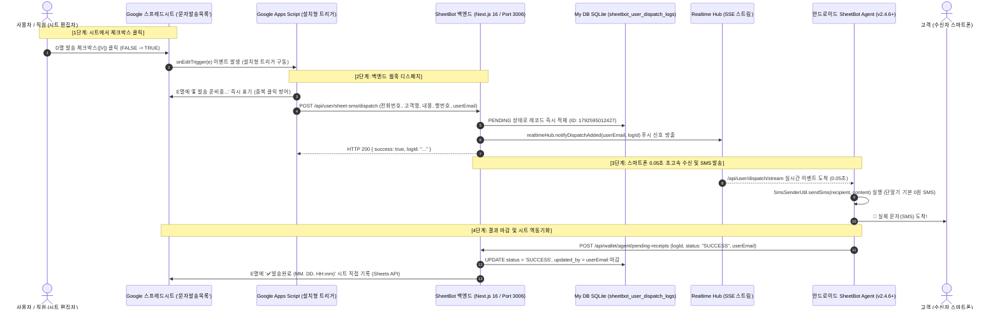

# 스프레드시트 체크박스 0원 문자 발송 파이프라인 (Checkbox SMS Pipeline) 📱⚡

> **구글 스프레드시트 체크박스(`[V]`) 클릭 ➔ Apps Script 웹훅 ➔ SheetBot 백엔드 ➔ 스마트폰 에이전트(0원 발송) ➔ 시트 결과 자동 역반영**  
> 본 문서는 향후 어떤 AI 어시스턴트나 개발자도 길을 잃지 않도록, 시스템의 전 구간 동작 원리, Google Apps Script 코드 명세, 백엔드 API, 안드로이드 에이전트 연동 규격을 완벽하게 정리한 표준 기술 지침서입니다.

---

## 1. 전체 시스템 아키텍처 및 데이터 흐름도



---

## 2. 구글 스프레드시트 표준 규격

### 1) 표준 5대 열 구조 (`문자발송목록` 탭)
스마트폰 체크박스 문자 발송 대장은 반드시 아래 열 구조를 준수합니다:

| 열 번호 | 열 영문 | 헤더 명칭 | 필수 여부 | 설명 |
| :---: | :---: | :--- | :---: | :--- |
| **1열** | **A열** | `수신 번호` | **필수** | 수신자 전화번호 (예: `01072165884` 또는 `010-7216-5884`) |
| **2열** | **B열** | `고객명` | 선택 | 수신자 이름 (예: `명지수`) |
| **3열** | **C열** | `문자 내용` | **필수** | 발송할 실제 문자 본문 |
| **4열** | **D열** | `발송 [V]` | **필수** | 체크박스 (`TRUE` / `FALSE`) |
| **5열** | **E열** | `발송 결과 및 일시` | 자동 | `⏳ 발송 준비중...` ➔ `✅ 발송완료 (10. 22. 00:05)` 자동 기입 |

---

## 3. Google Apps Script (GAS) 코드 표준 명세

### ⚠️ [절대 주의] 단순 트리거(`onEdit`) vs 설치형 트리거(`Installable Trigger`)
- **단순 트리거(`onEdit`)**: 구글 보안 정책상 외부 네트워크 통신(`UrlFetchApp.fetch`)이 **원천 차단**됩니다. 호출 시 `You do not have permission to call UrlFetchApp.fetch` 오류가 발생합니다.
- **설치형 트리거(`Installable Trigger`)**: 반드시 함수명을 `onEditTrigger(e)` 등으로 지정하고, `ScriptApp.newTrigger` 또는 Apps Script UI 트리거 메뉴에서 **'스프레드시트 편집 시'** 이벤트로 등록해야 외부 API 호출이 정상 수행됩니다.

### 📋 공식 Apps Script 소스 코드 (`Code.gs`)

```javascript
/**
 * 🚀 SheetBot 스프레드시트 체크박스 0원 문자 발송 스크립트
 * 
 * 스프레드시트 D열의 체크박스를 클릭([V])하면 SheetBot 백엔드로
 * 즉시 웹훅을 전송하여 연동된 스마트폰에서 0원으로 문자를 발송합니다.
 */

// 1. 설정값 (공식 프로덕션 엔드포인트)
var SHEETBOT_CONFIG = {
  ENDPOINT: "https://sheetbot.cloud/api/user/sheet-sms/dispatch",
  TARGET_TAB: "문자발송목록", // 대상 탭 이름
  CHECKBOX_COL: 4,          // D열 (발송 체크박스)
  RESULT_COL: 5             // E열 (결과 표기열)
};

/**
 * 🎯 설치형 편집 감지 트리거 (Installable Trigger)
 * 스프레드시트 편집 시 구글 시스템에 의해 자동 호출됩니다.
 */
function onEditTrigger(e) {
  try {
    if (!e || !e.range) return;

    var sheet = e.range.getSheet();
    var sheetName = sheet.getName();
    var col = e.range.getColumn();
    var row = e.range.getRow();
    var val = e.range.getValue();

    // 1. 유효성 검사 (대상 탭 및 헤더 행 제외, D열 체크박스 체크 여부)
    if (sheetName !== SHEETBOT_CONFIG.TARGET_TAB) return;
    if (row < 2) return; // 1행 헤더 제외
    if (col !== SHEETBOT_CONFIG.CHECKBOX_COL) return;
    if (val !== true && String(val).toUpperCase() !== "TRUE") return;

    // 2. 해당 행의 발송 데이터 추출
    var phone = String(sheet.getRange(row, 1).getValue() || "").trim(); // A열: 수신 번호
    var customerName = String(sheet.getRange(row, 2).getValue() || "").trim(); // B열: 고객명
    var message = String(sheet.getRange(row, 3).getValue() || "").trim(); // C열: 문자 내용

    if (!phone) {
      sheet.getRange(row, SHEETBOT_CONFIG.RESULT_COL).setValue("⚠️ 전화번호 누락");
      return;
    }
    if (!message) {
      sheet.getRange(row, SHEETBOT_CONFIG.RESULT_COL).setValue("⚠️ 문자 내용 누락");
      return;
    }

    // 3. 중복 발송 방지를 위해 E열에 즉시 '진행중' 표시
    sheet.getRange(row, SHEETBOT_CONFIG.RESULT_COL).setValue("⏳ 발송 준비중...");
    SpreadsheetApp.flush();

    // 4. 발송 주체 사용자 이메일 식별 (Multi-tenant User Attribution)
    // - e.user: 이벤트 발생 사용자
    // - Session.getActiveUser(): 현재 시트를 편집 중인 사용자
    // - Session.getEffectiveUser(): 스크립트/트리거 실행 권한자
    var userEmail = "";
    if (e.user && typeof e.user.getEmail === "function") {
      userEmail = e.user.getEmail();
    }
    if (!userEmail) {
      try { userEmail = Session.getActiveUser().getEmail(); } catch (err) {}
    }
    if (!userEmail) {
      try { userEmail = Session.getEffectiveUser().getEmail(); } catch (err) {}
    }

    if (!userEmail) {
      sheet.getRange(row, SHEETBOT_CONFIG.RESULT_COL).setValue("⚠️ 사용자 이메일 감지 불가 (로그인/권한 확인 필요)");
      return;
    }

    // 5. 시트 메타데이터 조립
    var ss = SpreadsheetApp.getActiveSpreadsheet();
    var spreadsheetId = ss.getId();

    var payload = {
      userEmail: userEmail,
      phoneNumber: phone,
      customerName: customerName,
      messageText: message,
      spreadsheetId: spreadsheetId,
      tabName: sheetName,
      rowIndex: row
    };

    // 6. SheetBot 백엔드로 웹훅 발송 (Fast-Return)
    var options = {
      method: "post",
      contentType: "application/json",
      payload: JSON.stringify(payload),
      muteHttpExceptions: true
    };

    var response = UrlFetchApp.fetch(SHEETBOT_CONFIG.ENDPOINT, options);
    var resCode = response.getResponseCode();
    var resBody = response.getContentText();

    if (resCode === 200) {
      // 대기열 적재 성공 -> 스마트폰이 발송 후 최종 '✅ 발송완료'로 갱신함
      sheet.getRange(row, SHEETBOT_CONFIG.RESULT_COL).setValue("📱 스마트폰 대기열 등록 (발송대기)");
    } else {
      sheet.getRange(row, SHEETBOT_CONFIG.RESULT_COL).setValue("❌ 오류 (" + resCode + "): " + resBody);
    }
  } catch (err) {
    console.error("[onEditTrigger Error]", err);
  }
}

/**
 * 🛠️ 원클릭 트리거 설치 함수 (관리자용 1회 실행)
 * Apps Script 에디터에서 이 함수를 선택하고 [실행]을 누르면 설치형 트리거가 자동 등록됩니다.
 */
function installSmsTrigger() {
  // 기존 등록된 onEditTrigger 중복 제거
  var triggers = ScriptApp.getProjectTriggers();
  for (var i = 0; i < triggers.length; i++) {
    if (triggers[i].getHandlerFunction() === "onEditTrigger") {
      ScriptApp.deleteTrigger(triggers[i]);
    }
  }

  // 스프레드시트 편집 시 작동하는 신규 트리거 생성
  ScriptApp.newTrigger("onEditTrigger")
    .forSpreadsheet(SpreadsheetApp.getActive())
    .onEdit()
    .create();

  SpreadsheetApp.getActiveSpreadsheet().toast(
    "체크박스 문자 발송 트리거가 성공적으로 설치되었습니다!", 
    "설치 완료", 
    5
  );
}
```

---

## 4. 백엔드 API 명세

### 1) `POST /api/user/sheet-sms/dispatch`
- **목적**: 스프레드시트에서 전송된 웹훅을 수신하여 `sheetbot_user_dispatch_logs`에 적재하고 안드로이드 기기에 SSE 푸시.
- **Request Payload**:
  ```json
  {
    "userEmail": "minseochh02@gmail.com",
    "phoneNumber": "01072165884",
    "customerName": "명지수",
    "messageText": "안내 문자 내용입니다.",
    "spreadsheetId": "1lpQY6WqssExzjY1vfJxMtogw9ElgWZU4hwg7EXdRwjs",
    "tabName": "문자발송목록",
    "rowIndex": 2
  }
  ```
- **Response (200 OK)**:
  ```json
  {
    "success": true,
    "logId": "1792595012427",
    "recipient": "01072165884",
    "status": "PENDING",
    "message": "스마트폰 문자 발송 대기열에 등록되었습니다."
  }
  ```

### 2) `GET /api/user/dispatch/stream` (SSE 푸시 엔드포인트)
- **목적**: 안드로이드 SheetBot Agent가 백그라운드에서 실시간으로 신규 발송 작업을 수신(`keepAliveService`).
- **인증**: `X-User-Email` 헤더 또는 쿼리스트링 `email`.
- **전송 데이터**:
  ```
  event: dispatch_added
  data: {"userEmail":"minseochh02@gmail.com","logId":"1792595012427","recipient":"01072165884","timestamp":1792595012427}
  ```

### 3) `POST /api/wallet/agent/pending-receipts`
- **목적**: 스마트폰 에이전트가 단말기 SMS 발송을 마친 후 대기열을 마감(`SUCCESS`)하고 시트에 결과를 역반영.
- **Request Payload**:
  ```json
  {
    "userEmail": "minseochh02@gmail.com",
    "receiptId": "1792595012427",
    "logId": "1792595012427",
    "status": "SUCCESS"
  }
  ```
- **백엔드 처리 로직**:
  1. `sheetbot_user_dispatch_logs`에서 `id = 1792595012427` 레코드 조회.
  2. `status = 'SUCCESS'`, `updated_by = userEmail` 업데이트.
  3. `rule_id`에 저장된 `{ spreadsheetId, tabName, rowIndex }` 메타데이터를 파싱.
  4. Google Sheets API를 호출하여 시트 E열(5번째 열)에 `✅ 발송완료 (MM. DD. HH:mm)` 자동 기록.

---

## 5. 안드로이드 사용자 에이전트 (Android Agent v2.4.6+) 연동 규격

1. **`KeepAliveService.kt`**:
   - `startDispatchSseLoop()`를 통해 `/api/user/dispatch/stream`을 구독하여 이벤트 발생 즉시 0.05초 만에 발송 실행.
   - 네트워크 단절 대비 15초 주기 폴링 백업(`fetchPendingReceipts`) 동시 가동.
2. **`SmsSenderUtil.kt`**:
   - 체크박스 발송 설정(`isSheetSmsCheckboxEnabled`) 독립 검증 (영수증 발송 옵션이 꺼져 있어도 체크박스 문자는 정상 발송).
   - 템플릿 하이재킹 방어: 시트에서 작성된 순수 본문(`receipt.message`)을 100% 원본 그대로 전송.
3. **완료 콜백 및 대기열 클린업**:
   - 발송 완료 시 `logId`를 담아 `/api/wallet/agent/pending-receipts`에 보고하여 대기열 적재 레코드가 좀비처럼 남지 않고 즉시 `SUCCESS`로 청소됨.

---

## 6. 트러블슈팅 및 핵심 주의사항 (Gotchas)

1. **ID 포맷 통일 (Numeric String)**:
   - 과거 `disp_179259...` 형태의 접두사를 사용할 경우 안드로이드 DTO(`Long` 또는 `BigInteger`)와 타입 불일치가 발생할 수 있었습니다.
   - 현재 모든 발송 ID는 순수 숫자형 문자열(`String(Date.now() + Math.floor(Math.random() * 1000))`)로 일원화되어 있습니다.
2. **소프트 삭제 필터링 (`deleted_at IS NULL`)**:
   - 대기열 조회 시 소프트 삭제된 항목이 재발송되지 않도록 모든 쿼리에 `deleted_at IS NULL` 필터가 적용되어 있습니다.
3. **사용자별 격리 (Multi-User Isolation)**:
   - 모든 대기열 등록 및 마감은 `user_email` 기준으로 엄격히 분리되며, 타 회원의 기기가 다른 회원의 문자를 가로채 발송하지 못하도록 격리되어 있습니다.
