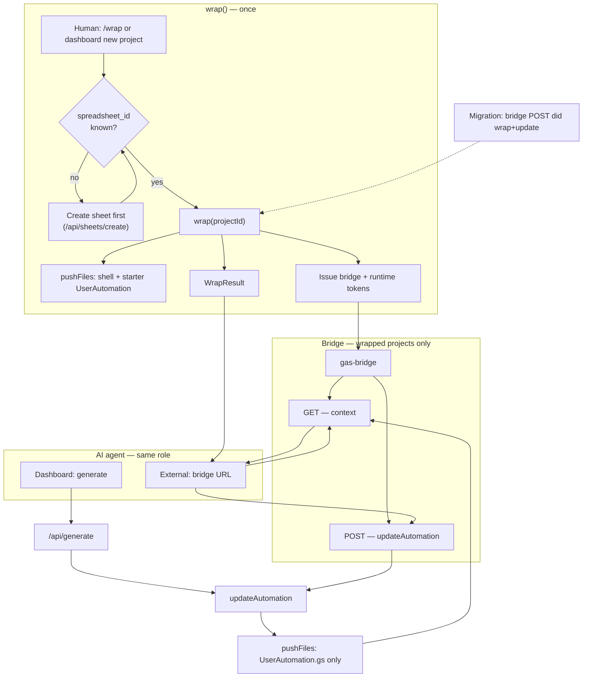
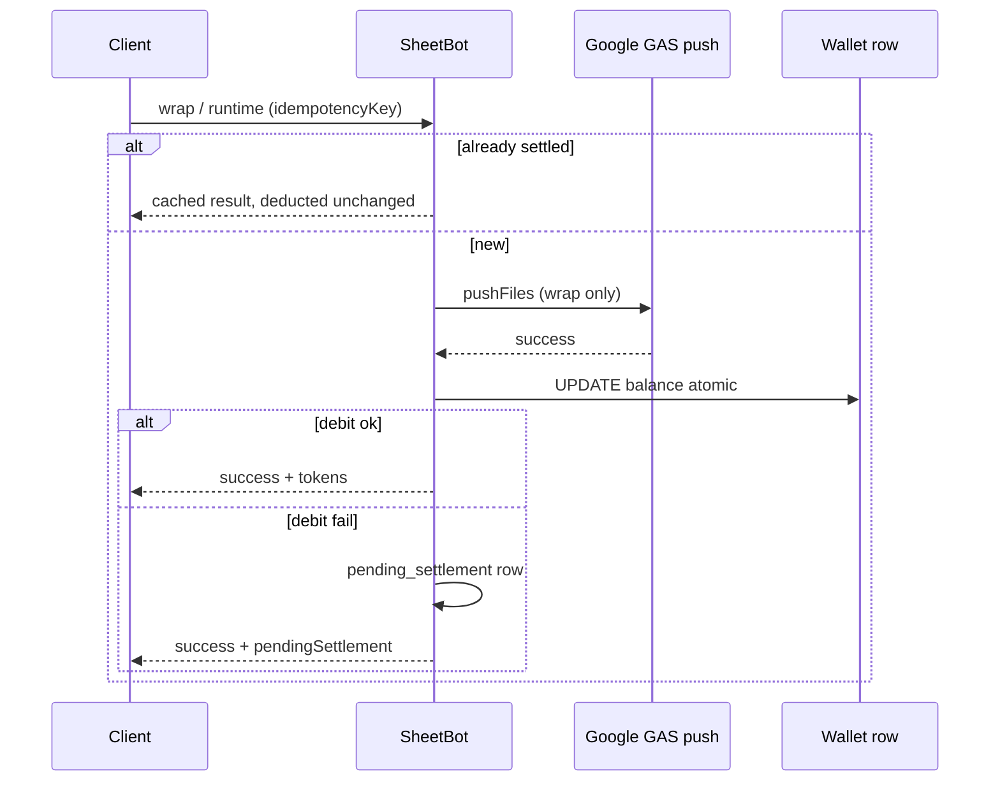
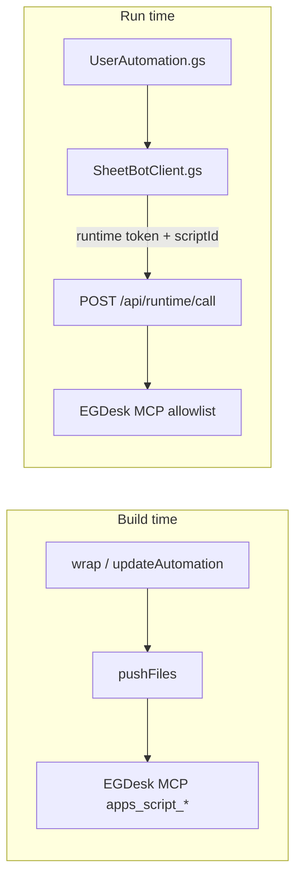
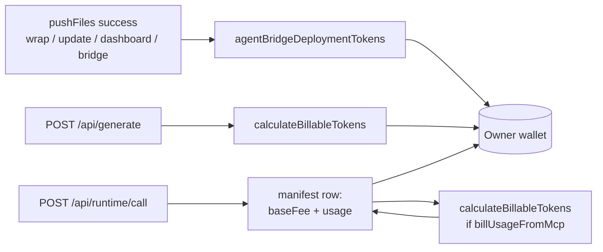

# SheetBot — Sheet Wrapping (spec)

How SheetBot attaches AI-generated automation to a Google Sheet.

> **Status:** Canonical **target design**. Sections marked **Migration** describe gaps vs code today.
>
> **Implementation:** `[WRAPPING-PLAN.md](WRAPPING-PLAN.md)`. Broader ops: `[README.md](../README.md)`.

---

## Mental model

Three **roles** (agent, bridge, wrapped sheet) and three **operations** (do not conflate the last two):


| Role         | Meaning                                                                                                                                                                     |
| ------------ | --------------------------------------------------------------------------------------------------------------------------------------------------------------------------- |
| **Wrapping** | **Once per project:** bind Apps Script to the spreadsheet, push the **shell** + starter `**UserAutomation.gs`**, set `wrapped_at`, issue **bridge** and **runtime** tokens. |
| **Bridge**   | Connects an **AI agent** to a **wrapped** project. **GET** reveals sheet + shell contract + current automation. **POST** runs an **automation update** (not a wrap).        |
| **AI agent** | Writes `**UserAutomation.gs`** only — dashboard `/api/generate`, Antigravity, Cursor, etc.                                                                                  |


| Operation                               | When                                       | What                                                                                                                                                                                  |
| --------------------------------------- | ------------------------------------------ | ------------------------------------------------------------------------------------------------------------------------------------------------------------------------------------- |
| `**wrap(projectId)**`                   | **Once** (until re-wrap / shell migration) | Create or bind script; push shell + starter user file via internal push; mint **bridge + runtime tokens**; set `wrapped_at`; return `**WrapResult`**.                                 |
| `**updateAutomation(projectId, code)**` | **Many times**                             | Requires `wrapped_at`; push `**UserAutomation.gs` only** (unless shell version forces refresh); **reuse** existing runtime token; bill; archive; return `**AutomationUpdateResult`**. |
| `**pushFiles(...)**`                    | Internal                                   | Sole caller of `apps_script_push_to_google`. Used by `wrap` and `updateAutomation` — **not** a public lifecycle step.                                                                 |


`**deploy()**` in code today is a conflation of wrap + update. In this spec, `**deploy` means `pushFiles**` (implementation detail). User-facing language: **wrap** and **update automation**.

"Wrapped" = `wrapped_at` is set and the bound project contains the SheetBot shell. **Bridge tokens are issued only when wrap succeeds.** An agent without a wrapped sheet gets **no bridge access** (no token, or GET/POST `**409 NOT_WRAPPED`**).

### Tokens (wrap vs update)


| Token       | Issued            | On update                                                                                                                                                    |
| ----------- | ----------------- | ------------------------------------------------------------------------------------------------------------------------------------------------------------ |
| **Bridge**  | `**wrap()` only** | Unchanged; same URL for the project                                                                                                                          |
| **Runtime** | `**wrap()` only** | **Reused** — `updateAutomation` does **not** mint a new runtime token or rewrite `SheetBotClient.gs` unless the **shell version** requires a full shell push |


### What the bridge reveals (GET)

Requires `**wrapped_at**`. Otherwise `**409 NOT_WRAPPED**`.

1. **Sheet** — structure, headers, samples.
2. **Shell contract** — hooks, **published MCP manifest** (see [catalog](WRAPPING-MCP-CATALOG.md)), helpers, reserved names ([Shell contract](#shell-contract--basegs-and-egdesk-mcp)).
3. **Current `UserAutomation.gs`** + archive.
4. **Instructions** — POST body is user file only.

### What the bridge applies (POST)

`**updateAutomation**` — not `wrap`. Requires `**wrapped_at**`; else `**409 NOT_WRAPPED**`.

1. Optional balance hint (if push fee > 0).
2. Sanitize code → `pushFiles` with **user file only** (default).
3. **`settleWalletDebit`** after push + DB success (idempotent per push receipt).

Loop: GET → agent edits → POST → GET.




### Dashboard flow (target)

**New project** is not "generate then deploy in one step." It is:

1. **Wrap** — shell + starter on sheet (`wrap` or `POST` dedicated wrap endpoint).
2. **Generate** — `/api/generate` → `UserAutomation.gs` draft (no push).
3. **Update** — `updateAutomation` or `POST /api/projects` update path with generated code.

Hand-off: `**WrapResult.agent**` (bridge URL) for a later external agent. In-app path skips the HTTP bridge but uses the same **update** semantics.

### `/wrap` quick-wrap (target)

1. Resolve or create **`spreadsheet_id`** (create sheet via API if user chose new sheet — **no wrap without an id**).
2. **`wrap(projectId)`** — full success or **error** (no partial "bridge only"). **Idempotent:** if this spreadsheet is already wrapped for the project, return the existing **`WrapResult`** with **`idempotentReplay: true`** and **no push fee** (see [Idempotency](#idempotency-and-consistency)).
3. Return **`WrapResult`** only.

> **Migration:** quick-wrap may issue a bridge token without `wrapped_at`; bridge POST may still perform first-time shell push. Target removes that path. Double-submit today can create duplicate projects or bridge charges — fixed by **`wrapped_at`** + per-spreadsheet idempotency.

---

## Core rule (push)

> **Only `pushFiles(...)` calls `apps_script_push_to_google`.** `wrap` and `updateAutomation` are the production entry points; routes call those, not MCP push directly.

**Temporary exceptions:** `projects/sync-code/route.ts`, `user/commands/promote/route.ts` — migrate to `updateAutomation` / `wrap` or retire. See [WRAPPING-PLAN.md](WRAPPING-PLAN.md).

### `wrap(projectId, opts?)` (summary)

1. Load project; require `spreadsheet_id` and visitor session.
2. **Idempotent short-circuit:** if **`wrapped_at`** is already set for this project **and** `gas_project_id` is bound → build **`WrapResult`** from DB (bridge URL, deployment ids), set **`idempotentReplay: true`**, **`tokens.deducted = 0`**, return **without** `pushFiles` or minting new tokens.
3. **Concurrency:** acquire a **per-`spreadsheet_id` wrap lock** (DB row or `wrap_started_at` + TTL). Second concurrent caller gets **`409 WRAP_IN_PROGRESS`** with `Retry-After` — not a second script project or second charge.
4. Bind or create Apps Script project (only when step 2 did not return).
5. Build shell (incl. `SheetBotClient.gs` + **new runtime token** when runtime is enabled).
6. Push shell + `STARTER_USER_AUTOMATION` (or opts) via `pushFiles` + **push settlement** (below).
7. Set `gas_project_id`, `script_code`, **`wrapped_at`**, issue bridge token; release wrap lock.
8. Optional web app if starter/user code needs `doGet` / `HtmlService`.

**Uniqueness (target):** at most one **active** SheetBot project per **`spreadsheet_id`** per owner (or global per sheet — product choice). `/wrap` resolves project by sheet before creating a duplicate row.

### `updateAutomation(projectId, userAutomationCode, opts?)` (summary)

1. Load project; `**if (!wrapped_at) throw NOT_WRAPPED**`.
2. Sanitize user code.
3. If project `shell_version` is behind server → `pushFiles` full shell (still **same runtime token** unless rotation policy says otherwise); else `**pushFiles` UserAutomation.gs only**.
4. Update `script_code`, archive, optional webapp bump.
5. On successful `pushFiles`, run **push fee** (below) — same as `wrap`.

### Push fee (every successful Apps Script push)

Any time SheetBot completes `apps_script_push_to_google` through **`pushFiles`** (full shell on **`wrap`**, user-only on **`updateAutomation`**, dashboard redeploy, bridge POST, etc.):

1. **`checkTokenBalance`** is a **hint only** — final charge uses **atomic settlement** (see [Wallet settlement](#wallet-settlement-atomic-deduction-and-push-without-pay)).
2. Push; on failure → **no** settlement row.
3. On success → **`settleWalletDebit`** with idempotency key **`gas-push:{projectId}:{pushReceiptId}`** (receipt from push metadata or content hash), then **`recordAiUsageLog`**.

Amount: **`agentBridgeDeploymentTokens`** in `getAiModelSettings()` (default **500**; admin **0** = free). Fixed per push — not code size, not LLM usage.

**Implementation:** one helper inside `sheetbot-deploy-service.ts` (or at the bottom of `pushFiles`) so routes do not duplicate gas-bridge billing. **Migration:** only **`gas-bridge` POST** charges today; dashboard `POST /api/projects` does not — centralizing push fixes that.

**Separate from generate:** `/api/generate` still bills **AI usage** in addition; a dashboard flow wrap → generate → update can incur **generate tokens + one push fee** (or two push fees if wrap and update are separate pushes).

---

## Idempotency and consistency

Money and Google state must stay aligned under double-clicks, `UrlFetchApp` retries, and parallel requests.

### Wrap — idempotent per spreadsheet

| Situation | Behavior |
|-----------|----------|
| **`wrapped_at` already set** for project | **200** + full **`WrapResult`**, **`idempotentReplay: true`**, **`tokens.deducted: 0`**, no `pushFiles`, no new `gas_project_id` |
| **Second click while first wrap in flight** | **`WRAP_IN_PROGRESS`** / **`CONFLICT`** (`wrap_in_progress`) + **`Retry-After`** |
| **New project row for same `spreadsheet_id`** | Prevent at API layer: upsert/find-by-sheet before `insertRows` |

`pushReceiptId` for the one successful wrap push is stored on the project (or settlement ledger) so a **retry after timeout** does not run a second full shell push if the first push actually succeeded.

### Runtime — idempotency key (`UrlFetchApp` retries)

GAS may repeat the same HTTP request. Runtime billing must not double-charge.

**Request** (`POST /api/runtime/call`):

```ts
{
  scriptId: string;
  service: string;
  tool: string;
  arguments: Record<string, unknown>;
  /** Required from sheet client. Stable per logical user action (UUID or hash). */
  idempotencyKey: string;
}
```

Or header **`Idempotency-Key`** (same value). **`SheetBotClient.gs`** generates once per `sheetbotCall_` invocation and sends it on every retry.

**Server:**

1. Lookup **`sheetbot_billing_idempotency`** (target table) by **`(project_id, idempotency_key)`** or global hash.
2. **Hit** → return **cached JSON** (MCP result + `tokens`) with **no second debit**.
3. **Miss** → proxy MCP → **`settleWalletDebit`** once → persist row with response snapshot + `deducted` + TTL (e.g. 24–72h).

Keys must be **unique per intended charge**. Reusing the same key with a **different** body → **`IDEMPOTENCY_KEY_MISMATCH`** or **`CONFLICT`** (`conflictReason: "idempotency_mismatch"`).

### Wallet settlement — atomic deduction and “push without pay”

**Problem today (migration):** `deductTokens` read-modify-writes the wallet row; concurrent calls can all pass `checkTokenBalance` then overdraw; push can succeed while deduct throws or returns `success: false`.

**Target:** all wallet debits go through **`settleWalletDebit`** in `token-wallet.ts` (or successor):

```ts
type SettleWalletDebitInput = {
  userEmail: string;
  amount: number;
  idempotencyKey: string;       // required for push + runtime; recommended for generate
  kind: "gas-push" | "runtime" | "generate" | "other";
  metadata?: Record<string, unknown>;
};

type SettleWalletDebitResult =
  | { status: "settled"; deducted: number; newBalance: number; replay: false }
  | { status: "settled"; deducted: number; newBalance: number; replay: true }  // idempotent replay
  | { status: "insufficient_funds"; balance: number }  // API: INSUFFICIENT_BALANCE
  | { status: "pending_settlement"; settlementId: string };  // push already succeeded; debit queued
```

**Atomic debit (single SQL semantics):**

```sql
UPDATE sheetbot_user_wallets
SET balance_tokens = balance_tokens - :amount,
    total_used_tokens = total_used_tokens + :amount,
    updated_at = :now
WHERE id = :wallet_id
  AND deleted_at IS NULL
  AND balance_tokens >= :amount   -- strict mode: no overdraft from race
RETURNING balance_tokens;
```

- **`strictBalance: true`** (default for wrap/update preflight): `0` rows updated → **`insufficient_funds`** — no negative balance from concurrency.
- **`allowDebt: true`** (optional product): omit the `>= :amount` guard so a **recorded debt** (negative balance) matches existing recharge copy; still **one** row update per settlement idempotency key.

After every successful update: **`invalidateServerCache(user_wallet_{email})`**.

**Push succeeds, settlement fails**

| Step | Action |
|------|--------|
| 1 | Google push **already committed** — do not roll back GAS |
| 2 | Insert **`sheetbot_wallet_settlements`** row: `status: pending`, `amount`, `idempotency_key`, `project_id`, `kind: gas-push` |
| 3 | Return to caller: deployment **success** + wallet block `{ pendingSettlement: true, settlementId }` **or** fail closed on wrap if product requires paid-before-wrap (choose **success + debt** for bridge/update so agent work is not lost) |
| 4 | **Sweeper** (cron / queue): retry `settleWalletDebit` with same idempotency key until `settled`; on success mark settlement `settled` |
| 5 | Block **new** pushes that need pre-paid balance while `pending_settlements` sum exceeds threshold (optional) |

**Generate / runtime** use the same settlement helper so retries and concurrency share one model.



---

## Automation model (runtime)


| When           | Who talks to EGDesk           | For what                                  |
| -------------- | ----------------------------- | ----------------------------------------- |
| **Build time** | SheetBot server               | `wrap` / `updateAutomation` → `pushFiles` |
| **Run time**   | SheetBot server for the sheet | Runtime API + allowlisted tools           |





Runtime rules unchanged: scriptId binding, spend cap, allowlist. Token created at **wrap**, not per agent POST.

### Bridge token vs runtime token


|                         | Bridge token                | Runtime token            |
| ----------------------- | --------------------------- | ------------------------ |
| Used by                 | Coding agents (HTTP bridge) | Sheet script at run time |
| Issued                  | `**wrap()**`                | `**wrap()**`             |
| Can call `wrap`?        | **No**                      | **No**                   |
| Can `updateAutomation`? | **Yes** (via bridge POST)   | **No**                   |


---

## Files on the sheet


| File                                    | Owner     | Touch on wrap   | Touch on update            |
| --------------------------------------- | --------- | --------------- | -------------------------- |
| `Base.gs`                               | Server    | Yes             | Only if shell version bump |
| `SheetBotClient.gs`                     | Server    | Yes (new token) | No (default)               |
| `UserAutomation.gs`                     | AI / user | Starter         | Yes                        |
| `TokenRecharge.gs`, `Code.gs`, manifest | Server    | Yes             | Only with shell bump       |

**Migration:** shell still ships **`EgdeskConfig.gs`** + MCP-injected **`EgdeskClient.gs`** instead of `SheetBotClient.gs`. The MCP surface below is the same; only the transport (tunnel URL/key vs runtime token) changes.

---

## Shell contract — `Base.gs` and EGDesk MCP

Agents writing **`UserAutomation.gs`** must not reimplement the platform. **`Base.gs`** (and sibling server files) define **UI + spreadsheet helpers**; the **platform client** file defines **how to reach EGDesk MCP at run time**. Bridge **GET** must return this contract (and optionally a read-only snapshot of `Base.gs` + client file names) so coding agents do not invent `UrlFetchApp` + API keys.

### Division of responsibility

| Layer | File(s) | Agent may edit? | Role |
|-------|---------|-----------------|------|
| Menu / lifecycle | **`Base.gs`** | **No** | `onOpen`, hooks into user code, `toast_`, sheet helpers, copilot entry |
| MCP transport | **`SheetBotClient.gs`** (target) or **`EgdeskClient.gs`** (today) + config | **No** | Single entrypoint to EGDesk tools (allowlisted) |
| Wallet UI | **`TokenRecharge.gs`** | **No** | Recharge modal; uses `egdeskToolsCall('user-data', …)` internally |
| Business logic | **`UserAutomation.gs`** | **Yes** | Menus, triggers, handlers — **calls** platform APIs below |

### `Base.gs` — what it defines (server-owned)

**Lifecycle (only in Base):**

- `onOpen(e)` — builds **🚀 SheetBot 메뉴**, calls user hooks, adds copilot menu item when `showAiCopilotSidebar` exists (copilot implementation lives in embedded Base block or sidebar template fetch).

**User hooks (implement in `UserAutomation.gs`, invoked from Base):**

| Hook | Signature | Purpose |
|------|-----------|---------|
| `registerSheetBotMenuItems_` | `(menu) → menu?` | Add business menu items **above** the separator; return extended menu if needed |
| `installSheetBotTriggers_` | `()` | Create `ScriptApp` triggers (time/edit); Base calls once from `onOpen` |
| `onSheetBotOpen_` | `(e)` | Run after menu/triggers on open |
| `onSheetBotEdit_` | `(e)` | Optional; wire from user’s `onEdit` if needed |

**Helpers UserAutomation may call (stable names — do not redefine):**

| Function | Purpose |
|----------|---------|
| `toast_(message, title?, seconds?)` | Spreadsheet toast |
| `getSheetByName_(name)` | `getSheetByName` with clear error |
| `getTunnelStatusData()` | Quick EGDesk/user-data connectivity check (uses client if present) |

**Copilot (Base / embedded runtime — do not duplicate in user file):**

- `showAiCopilotSidebar()` — sidebar UI; loads remote template from SheetBot where configured.
- Related reserved names: `getAiCopilotSidebarHtml`, `getUserTokenBalanceData`, `updateSheetBotMenuWithBalance`, `openTokenRechargeModal`, `openSheetBotGuide` (see reserved list in `user-automation-schema.ts`).

**Reserved — never define in `UserAutomation.gs`:**  
`onOpen`, `onEdit`, `onInstall`, `doGet`, `doPost`, all hook/helper names above, `egdeskToolsCall`, `sheetbotCall_`, `executeUninstallSheetBot`, etc. (full set: `RESERVED_GAS_FUNCTION_NAMES` in code).

### Platform client — EGDesk MCP surface (for `UserAutomation.gs`)

User automation **must not** call EGDesk with raw `UrlFetchApp` or user-supplied API keys. Use the shell’s client only.

#### Today (`EgdeskClient.gs` + tunnel)

Low-level:

```js
egdeskToolsCall(service, tool, args)  // POST {tunnelUrl}/{service}/tools/call
```

Wrappers UserAutomation should prefer:

| Area | Call pattern | EGDesk MCP `service` / `tool` |
|------|----------------|-------------------------------|
| **LLM** | `egdeskToolsCall('ai-caller', 'ai_caller_call', { model, messages, … })` | `ai-caller` / `ai_caller_call` |
| Models list | `egdeskToolsCall('ai-caller', 'ai_caller_list_models', {})` | `ai-caller` / `ai_caller_list_models` |
| **User DB** | `egdeskUserDataQuery(table, { filters, limit, … })` or `queryTable(...)` | `user-data` / `user_data_query` |
| SQL (parameterized) | `egdeskUserDataSql(query)` | `user-data` / `user_data_sql_query` |
| List tables | `egdeskUserDataListTables()` | `user-data` / `user_data_list_tables` |
| **SMS / Agent2** | — | **Future** — not in runtime manifest; existing Base menus + legacy tunnel unchanged ([catalog](WRAPPING-MCP-CATALOG.md#future--phone--agent2-out-of-scope)) |

**AI response parsing (client helpers — use instead of ad-hoc JSON):**

| Helper | Use when |
|--------|----------|
| `egdeskExtractAiText(aiRes)` | Plain text from `ai_caller_call` payload |
| `egdeskExtractAiJson(aiRes)` | Structured JSON (OCR, extraction) |

Typical pattern:

```js
var raw = egdeskToolsCall('ai-caller', 'ai_caller_call', {
  model: 'gemini-3.8-flash',
  messages: [{ role: 'user', content: prompt }]
});
var text = egdeskExtractAiText(raw);
// or
var data = egdeskExtractAiJson(raw);
```

**Not available from the sheet (build-time only):** any `apps_script_*` tool (push, create project, bind spreadsheet, tunnel setup). Those run on SheetBot server during `wrap` / `updateAutomation`.

#### Target (`SheetBotClient.gs` + `/api/runtime/call`)

Same **logical** tools; different transport:

```js
sheetbotCall_(service, tool, args)  // runtime token; scriptId; idempotencyKey per invocation
```

**Which services/tools exist** is not decided in runtime code alone. SheetBot publishes a **versioned MCP catalog** — you choose exposure per service/tool; code enforces that manifest.

→ **[`WRAPPING-MCP-CATALOG.md`](WRAPPING-MCP-CATALOG.md)** — full EGDesk service inventory + **Expose to sheet?** columns for your decisions.

→ **`SHEET_RUNTIME_TOOL_EXPOSURE`** in `sheet-mcp-manifest.ts` (target) — flat per-tool rows from the catalog; shared by runtime, bridge `shellContract`, and docs.

**Today (interim):** `api/gateway/mcp/route.ts` `ALLOWED_TOOLS` is a small subset (ai-caller, user-data, phone). **Owner decisions:** see [`WRAPPING-MCP-CATALOG.md`](WRAPPING-MCP-CATALOG.md) signed manifest — widen MCP when runtime ships; **do not expand phone** in wrapping work.

Billing: every allowlisted runtime tool uses the **same wallet shape** (`baseFee` + `usage` → `deducted`); only **`ai-caller`** tools carry a non-zero **`baseFee`** (see [Runtime calls](#runtime-calls-single-wallet-shape)). Calls not in the manifest → **`MANIFEST_VIOLATION`**.

**Transport limits:** runtime calls originate in Apps Script **`UrlFetchApp`** (timeouts, response size, daily URL-fetch quota). Long synchronous **`ai_caller_call`** through the proxy can fail before the model finishes — prefer **batch/async** tools or a **server webhook** for heavy agent work ([Runtime transport](#runtime-transport-urlfetchapp-and-long-ai)).

`Base.gs` may expose a thin alias (e.g. document that user code should call `sheetbotCall_` only from client file, not reimplement in Base). **`sheetbotCall_`** must parse [API errors](#api-errors-sheet--bridge--dashboard) and route known codes to shell UX (recharge sidebar, not raw exceptions).

### What bridge GET should expose to agents

Include a machine-readable **`shellContract`** (versioned) with at least:

```ts
type ShellContract = {
  shellVersion: string;
  hooks: { name: string; signature: string; definedIn: 'UserAutomation.gs' }[];
  callableFromUser: { name: string; file: 'Base.gs' | 'EgdeskClient.gs' | 'SheetBotClient.gs' }[];
  mcp: {
    manifestVersion: string;       // e.g. SHEET_MCP_MANIFEST_VERSION
    transport: 'egdesk-tunnel' | 'sheetbot-runtime';
    entrypoint: 'egdeskToolsCall' | 'sheetbotCall_';
    exposedRuntimeTools: { service: string; tool: string }[]; // flat allowlist — WRAPPING-MCP-CATALOG (billing fields server-only)
    exposedSheetbot: { service: string; tool: string }[];     // empty until future Agent2 runtime
  };
  reservedFunctionNames: string[];
  aiParsingHelpers: string[];
  /** Stable error codes the shell knows how to present — mirror § API errors. */
  runtimeErrorCodes: SheetbotErrorCode[];
  /** Menu / sidebar entry for wallet recharge (e.g. `showTokenRechargeSidebar`). */
  rechargeUiAction: string;
};
```

Optional: `baseGsSource` / `clientGsSource` read-only snippets or full text for debugging (not for LLM to paste into user file).

### Agent rules (summary)

1. Implement **`registerSheetBotMenuItems_`**, triggers, and handlers in **`UserAutomation.gs`** only.
2. Call **LLM / DB** via **`egdeskToolsCall` / `sheetbotCall_`** per published manifest — never prompt users for Gemini/OpenAI keys. **SMS:** use existing SheetBot shell / Agent2 paths (not EGDesk MCP catalog); runtime SMS APIs are future.
3. Parse AI results with **`egdeskExtractAiText` / `egdeskExtractAiJson`** (or equivalent documented on contract).
4. Do not add second `onOpen` or copilot HTML in user file; use Base copilot menu item.
5. Prefer **`queryTable` / `user_data_query`** over raw SQL unless necessary.

---

## HTTP mapping (target)


| Route                                             | Operation                                                         | Response                                       |
| ------------------------------------------------- | ----------------------------------------------------------------- | ---------------------------------------------- |
| `POST /api/projects/quick-wrap`                   | `wrap` (after sheet id exists)                                    | `WrapResult`                                   |
| `POST /api/projects` create (target)              | `wrap` or create row then `wrap` — not generate+shell in one blob | `WrapResult`                                   |
| `POST /api/generate`                              | None (draft only)                                                 | `GeneratedAutomation`                          |
| `POST /api/projects` with new automation (target) | `updateAutomation`                                                | `AutomationUpdateResult`                       |
| `GET /api/agent/gas-bridge`                       | Read                                                              | `409` if not wrapped                           |
| `POST /api/agent/gas-bridge`                      | `updateAutomation`                                                | `AutomationUpdateResult`; `409` if not wrapped |


Billing on bridge POST: balance check → update → deduct on success (unchanged from current code).

---

## Response shapes

### `WrapResult` — `**wrap()` only**

```ts
type WrapAutomationSource = 'starter' | 'fallback';
// Dashboard first automation may use 'starter' until first update marks 'ai' | 'agent' on updates.

type WrapResult = {
  success: boolean;
  /** True when wrap was not re-run: already wrapped for this spreadsheet/project. */
  idempotentReplay?: boolean;
  project: {
    id: string;
    name: string;
    spreadsheetId: string;
    sheetUrl: string;
    wrappedAt: string;           // ISO
  };
  deployment: {
    gasProjectId: string;
    scriptUrl: string;
    webAppUrl: string | null;
    archiveId: string | null;
  };
  automation: {
    summary: string;
    features: string[];
    source: WrapAutomationSource;
  };
  agent: {
    bridgeUrl: string;
    promptTemplate: string;
  };
  tokens: { deducted: number; remainingBalance: number };
};
```

No `wrapped` flag (success implies wrapped). No `nextStep` — wrap fails or succeeds. No `spreadsheetId: null` success path.

### `AutomationUpdateResult` — `**updateAutomation()` / bridge POST**

```ts
type AutomationUpdateResult = {
  success: boolean;
  project: { id: string };
  deployment: {
    gasProjectId: string;
    scriptUrl: string;
    webAppUrl: string | null;
    deployedAt: string;
    archiveId: string | null;
    comment: string | null;
  };
  automation: {
    summary: string;
    features: string[];
    source: 'ai' | 'agent' | 'fallback';
  };
  tokens: { deducted: number; remainingBalance: number };
};
```

No `agent` block (caller already has bridge). No `wrapped` / `nextStep`.

### `GeneratedAutomation` — `/api/generate`

```ts
type GeneratedAutomation = {
  summary: string;
  features: string[];
  source: 'ai' | 'noop' | 'fallback';
  userAutomationCode: string;
};
```

### API errors (sheet + bridge + dashboard)

All JSON error responses use one envelope so **`SheetBotClient.gs`**, bridge agents, and the dashboard can branch on **`code`** (not HTTP status alone).

```ts
type SheetbotErrorCode =
  | "LOGIN_REQUIRED"
  | "NOT_WRAPPED"
  | "INSUFFICIENT_BALANCE"
  | "SPEND_CAP_EXCEEDED"
  | "RATE_LIMITED"
  | "MANIFEST_VIOLATION"
  | "CONFLICT"
  | "INVALID_RUNTIME_AUTH"   // bad token, wrong scriptId, copied sheet
  | "WRAP_IN_PROGRESS"       // also surfaced as CONFLICT.details.reason
  | "IDEMPOTENCY_KEY_MISMATCH"
  | "PENDING_SETTLEMENT"
  | `WRAP_${string}`         // e.g. WRAP_SHEET_MISSING, WRAP_OAUTH, WRAP_PUSH_FAILED
  | "INTERNAL_ERROR";

type SheetbotApiError = {
  code: SheetbotErrorCode;
  message: string;           // localized when request sends Accept-Language
  httpStatus: number;
  details?: {
    balance?: number;
    required?: number;
    rechargeUrl?: string;    // sheetbot.cloud recharge deep link
    retryAfterSeconds?: number;
    spendCap?: { window: "daily" | "monthly"; used: number; limit: number };
    service?: string;
    tool?: string;
    manifestVersion?: string;
    conflictReason?: "wrap_in_progress" | "idempotency_mismatch" | "already_wrapped";
    settlementId?: string;
  };
};

type SheetbotErrorResponse = { success: false; error: SheetbotApiError };
```

#### Catalog

| Code | HTTP | Typical APIs | When |
|------|------|--------------|------|
| **`LOGIN_REQUIRED`** | 401 | wrap, bridge, dashboard, runtime | No session / invalid runtime token |
| **`NOT_WRAPPED`** | 409 | bridge GET/POST, `updateAutomation` | `wrapped_at` unset |
| **`INSUFFICIENT_BALANCE`** | 402 | runtime, wrap, `updateAutomation`, `/api/generate` | Atomic settlement: `balance < required` (push fee, runtime `baseFee+usage`, generate estimate) |
| **`SPEND_CAP_EXCEEDED`** | 402 | runtime (primary) | Per-project daily/monthly token cap hit before proxy |
| **`RATE_LIMITED`** | 429 | runtime, bridge | Per-project / per-user / global throttle; honor **`Retry-After`** |
| **`MANIFEST_VIOLATION`** | 403 | runtime | `(service, tool)` not in `SHEET_RUNTIME_TOOL_EXPOSURE` (or future sheetbot bucket) |
| **`CONFLICT`** | 409 | wrap, runtime | Generic state conflict; see **`details.conflictReason`** |
| **`WRAP_IN_PROGRESS`** | 409 | wrap | Same as **`CONFLICT`** + `conflictReason: "wrap_in_progress"` |
| **`IDEMPOTENCY_KEY_MISMATCH`** | 409 | runtime | Same key, different body — or **`CONFLICT`** + `idempotency_mismatch` |
| **`INVALID_RUNTIME_AUTH`** | 403 | runtime | `scriptId !== gas_project_id`, revoked runtime token, stale copy |
| **`PENDING_SETTLEMENT`** | 200 or 402 | wrap, update | Push succeeded; wallet debit queued — **`details.settlementId`** |
| **`WRAP_SHEET_MISSING`** | 400 | wrap | No `spreadsheet_id` |
| **`WRAP_OAUTH`** | 403 | wrap | Visitor / Google OAuth not ready |
| **`WRAP_PUSH_FAILED`** | 502 | wrap, update | `pushFiles` / Google error |
| **`INTERNAL_ERROR`** | 500 | any | Unhandled server fault |

Prefer **stable `code`** values above; **`WRAP_*`** only for wrap-specific failures not covered by the table.

#### Sheet client UX (`SheetBotClient.gs` + `Base.gs`)

**`sheetbotCall_`** (and copilot paths) must not throw raw `Exception` text to end users. On non-2xx or `{ success: false }`:

```js
function sheetbotHandleApiError_(err) {
  var code = err.code || "INTERNAL_ERROR";
  switch (code) {
    case "INSUFFICIENT_BALANCE":
      // details.balance, details.required, details.rechargeUrl
      showTokenRechargeSidebar({
        reason: "low_balance",
        balance: err.details.balance,
        required: err.details.required,
      });
      break;
    case "SPEND_CAP_EXCEEDED":
      SpreadsheetApp.getUi().alert(
        "이 시트의 AI 사용 한도에 도달했습니다. 내일 다시 시도하거나 대시보드에서 한도를 확인하세요."
      );
      break;
    case "RATE_LIMITED":
      // optional: Utilities.sleep(details.retryAfterSeconds * 1000) for one auto-retry
      SpreadsheetApp.getUi().alert("요청이 많습니다. 잠시 후 다시 시도해 주세요.");
      break;
    case "MANIFEST_VIOLATION":
      SpreadsheetApp.getUi().alert("이 시트에서는 사용할 수 없는 기능입니다.");
      break;
    case "NOT_WRAPPED":
    case "INVALID_RUNTIME_AUTH":
      SpreadsheetApp.getUi().alert("시트봇 연결이 만료되었습니다. sheetbot.cloud에서 다시 래핑해 주세요.");
      break;
    case "CONFLICT":
    case "WRAP_IN_PROGRESS":
    case "IDEMPOTENCY_KEY_MISMATCH":
      // Usually safe to no-op or show soft message; idempotent replay may have succeeded server-side
      break;
    default:
      console.warn("[SheetBot]", code, err.message);
      SpreadsheetApp.getUi().alert(err.message || "시트봇 요청에 실패했습니다.");
  }
  return { ok: false, code: code, error: err };
}
```

Bridge GET **`shellContract`** should list **`runtimeErrorCodes`** and **`rechargeUiAction`** so external agents know recharge is a shell UI concern, not an MCP tool.

#### Dashboard / bridge agents

Same envelope. Agents should map **`INSUFFICIENT_BALANCE`** to “owner must recharge” and **`NOT_WRAPPED`** to “call wrap first”, not retry push blindly.

---

### Runtime transport (UrlFetchApp and long AI)

| Constraint | Implication |
|------------|-------------|
| **UrlFetchApp** timeouts | Default fetch budget is short; long LLM completions may abort in the sheet even when SheetBot + EGDesk are still working |
| **Daily URL-fetch quota** | High-frequency runtime tools can exhaust project quota |
| **Response size** | Very large MCP payloads may truncate |

**Patterns that fit the sheet:**

1. **Short calls** — `ai_caller_call` with fast models / small prompts through `sheetbotCall_`.
2. **Batch / async AI** — `ai_caller_batch_*` on EGDesk; sheet polls batch status with separate idempotency keys per poll (polls should be cheap or `billUsageFromMcp: false` on read tools).
3. **Agent webhook (recommended for heavy work)** — External agent (Antigravity, bridge) runs long jobs **off** UrlFetchApp; on completion POSTs to SheetBot **`/api/agent/...`** or bridge **`updateAutomation`** with results. Sheet only triggers a small “start job” runtime call or opens bridge URL — not a 5-minute synchronous proxy.
4. **Server-side callback (future)** — SheetBot accepts `callbackUrl` + `jobId` on runtime start, writes result to user-data or pushes a bounded notification the sheet reads on open.

Copilot and `UserAutomation.gs` should treat UrlFetch timeout as **`RATE_LIMITED`** or a dedicated client code (`URL_FETCH_TIMEOUT`) and avoid double-submit without a new **`idempotencyKey`**.

---

## Billing

Three **wallet line items** (they stack; do not merge):

| Line item | When | Amount |
|-----------|------|--------|
| **Apps Script push fee** | Every **successful** `pushFiles` (`wrap`, `updateAutomation`, dashboard push, bridge POST, …) | **`agentBridgeDeploymentTokens`** (default **500**; **0** = free) — see [Push fee](#push-fee-every-successful-apps-script-push) |
| **AI generation** | `/api/generate` (dashboard agent) | **`calculateBillableTokens`** from AI Caller usage (or char estimate) × model multiplier |
| **Runtime MCP** | Every allowlisted `POST /api/runtime/call` | **`baseFee`** from manifest (non-zero only for **`ai-caller`**) + **`usage`** via `calculateBillableTokens` when `billUsageFromMcp` |

**Bridge GET:** no push fee, no runtime wallet charge.

Shared AI math: `src/lib/token-calculator.ts`. Push fee is **not** usage-based — always the configured flat amount per successful Google push.

**Owner:** push fee and runtime bill **`project.user_email`**. Generate bills the **session user** (same person for owned projects). External agent LLM (Antigravity) is outside SheetBot; owner still pays **push fee** when bridge POST succeeds.

### Who pays (recap)

| Actor | SheetBot charges |
|-------|------------------|
| Owner | Push fee on each successful GAS push (all entry points) |
| Owner | `/api/generate` AI tokens (additional) |
| Owner | Runtime MCP wallet (`baseFee` + `usage` per call; see below) |
| External coding agent | Its own LLM — not SheetBot |

### Bridge vs dashboard (push fee is the same)

The bridge does **not** own a special fee. **`updateAutomation`** and **`wrap`** both call **`pushFiles`** → same **500** (or configured) on success whether the caller is **`gas-bridge` POST**, **`POST /api/projects`**, or quick-wrap **`wrap()`**.

| Action | Push fee | AI generation fee |
|--------|----------|-------------------|
| **GET** `gas-bridge` | — | — |
| **`wrap()`** / dashboard first push | **Yes** (one push) | — |
| **`updateAutomation`** (bridge or dashboard) | **Yes** (one push per success) | — |
| **`POST /api/generate`** | — | **Yes** (if not noop) |

**Order:** optional balance hint → `pushFiles` → **`settleWalletDebit`** (idempotent per push receipt) → audit log. See [Wallet settlement](#wallet-settlement-atomic-deduction-and-push-without-pay).

**`WrapResult.tokens` / `AutomationUpdateResult.tokens`:** `{ deducted: pushFee, remainingBalance }` for the push leg only — not LLM usage.

```text
Antigravity LLM     →  user’s agent bill
/api/generate       →  owner: AI tokens
any successful push →  owner: agentBridgeDeploymentTokens (via central pushFiles)
```

### Runtime calls — single wallet shape

The runtime is **run-time**: code in **`UserAutomation.gs`** (via **`SheetBotClient.gs`**) calls SheetBot while the user works in the sheet (copilot, OCR helpers, etc.).

**One code path** for every allowlisted `(service, tool)` — no separate “AI runtime” vs “other runtime” handlers. Each manifest row uses the same type; only **`ai-caller`** rows set a non-zero **`baseFeeTokens`** (all other services use **`0`**).

```ts
type SheetRuntimeToolExposure = {
  service: string;
  tool: string;
  /** Flat debit per successful proxy call. Non-zero only for `ai-caller` (see `runtimeAiCallerBaseFeeTokens`). */
  baseFeeTokens: number;
  /** When true, add usage from MCP result via calculateBillableTokens (e.g. ai_caller_call, ai_caller_generate_image). */
  billUsageFromMcp: boolean;
};

type RuntimeCallWallet = {
  baseFee: number;
  usage: number;
  deducted: number; // baseFee + usage
  remainingBalance: number;
};
```

| Example | `baseFeeTokens` | `billUsageFromMcp` | Typical `deducted` |
|--------|-----------------|--------------------|--------------------|
| `user-data` / `user_data_query` | **0** | false | **0** |
| `korean-law` / any tool | **0** | false | **0** |
| `ai-caller` / `ai_caller_list_models` | **`runtimeAiCallerBaseFeeTokens`** | false | base only |
| `ai-caller` / `ai_caller_call` | **`runtimeAiCallerBaseFeeTokens`** | true | base + usage |

Proxy succeeds → compute charge from manifest row → **`settleWalletDebit`** → return MCP payload + **`tokens: RuntimeCallWallet`**. Failures return **`SheetbotErrorResponse`** (e.g. **`INSUFFICIENT_BALANCE`**, **`SPEND_CAP_EXCEEDED`**, **`MANIFEST_VIOLATION`**) for **`sheetbotHandleApiError_`**. Audit log: `caller` e.g. `sheetbot-runtime`, `project_id`, `service`, `tool`, `gas_project_id` / `scriptId`, `baseFee`, `usage`.

Runtime rules (billing):

1. **Auth:** runtime token + **`scriptId === gas_project_id`** — else **`INVALID_RUNTIME_AUTH`** (no charge).
2. **Idempotency:** require **`idempotencyKey`**; replay cached response without a second **`settleWalletDebit`**.
3. **Preflight:** spend cap + optional balance hint; **authoritative** check is atomic **`settleWalletDebit`** for `baseFee + usage`.
4. **Postflight:** **`usage`** from `calculateBillableTokens` when `billUsageFromMcp`; else **`usage = 0`**; one settlement per key.
5. **No mint on update:** `updateAutomation` does not rotate runtime token; copied sheets with stale token/scriptId fail before billing.

**Migration:** sheets today often call EGDesk via tunnel / `api/gateway/mcp` with a user API key; audit may log without full wallet deduction. **Target:** all sheet-originated AI goes through `**/api/runtime/call`** with wallet + caps aligned with dashboard generate.




### Configuration


| Setting                       | Source                                         | Effect                                                          |
| ----------------------------- | ---------------------------------------------- | --------------------------------------------------------------- |
| `agentBridgeDeploymentTokens` | `sheetbot_settings` → `global_ai_model_config` | Flat fee per **successful `pushFiles`** (all routes) |
| `runtimeAiCallerBaseFeeTokens` | `sheetbot_settings` (target)                  | Flat **`baseFee`** per successful **`ai-caller`** runtime call only |
| Model multipliers             | `getModelTokenMultiplier`                      | Scales **`usage`** leg (generate + runtime when `billUsageFromMcp`) |
| Per-project spend cap         | Target DB / settings                           | Runtime (and optionally bridge POST count)                      |


### Response fields (recap)


| Response                 | `tokens.deducted` meaning                            |
| ------------------------ | ---------------------------------------------------- |
| `WrapResult`             | **Push fee** (`agentBridgeDeploymentTokens`) on successful wrap |
| `AutomationUpdateResult` | **Push fee** on successful update (not LLM tokens)   |
| `/api/generate`          | **AI generation** billable tokens                    |
| Runtime JSON (target)    | **`tokens`:** `{ baseFee, usage, deducted, remainingBalance }` |


---

## Data rules

- `sheetbot_projects.script_code` = **UserAutomation.gs** only.
- `**wrapped_at**` — set only by successful `wrap`; bridge/runtime tokens valid only after.
- `gas_project_id` — scriptId binding for runtime billing integrity.
- **`wrapped_at`** — idempotent wrap gate; **`spreadsheet_id`** — uniqueness + wrap lock scope.
- Settlement rows — source of truth for “charged once” alongside idempotency cache.
- **Generate / runtime usage leg:** bill on automation text or MCP usage, never on shell (`Base.gs`) bytes. Runtime **`baseFee`** only on **`ai-caller`** manifest rows.
- **Every successful GAS push:** bill **`agentBridgeDeploymentTokens`** to **owner** inside central `pushFiles` / deploy service — not char-length of code.

---

## Auth and infrastructure

- Google via `callAppsScriptTool` + visitor session (BYO).
- **New sheet:** create via `/api/sheets/create` (or equivalent), then **wrap** — not bridge token first.
- Public URLs: `bridge-public-url.ts`.

---

## Glossary

- **Wrap** — one-time `wrap()`: shell on sheet, tokens, `wrapped_at`.
- **Update automation** — `updateAutomation()`: user file push, bill, archive.
- **pushFiles** — internal Google push; not a user-facing verb.
- **Bridge** — agent read/write API on **wrapped** projects only.
- **AI agent** — produces `UserAutomation.gs`; never owns `Base.gs`.
- **Shell** — server-owned GAS files.
- **Runtime** — sheet → `/api/runtime/call` → EGDesk (allowlisted); unified **`baseFee` + `usage`** wallet (base fee only for **`ai-caller`**).
- **Apps Script push fee** — `agentBridgeDeploymentTokens` (default 500) per successful `pushFiles`; charged in central deploy service.

